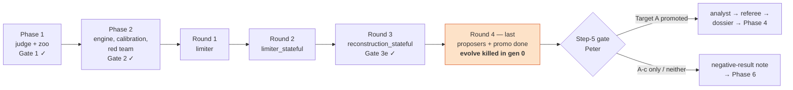

# Handoff — 2026-10-28

For the next session (or Peter). The working record is still docs/STATUS.md; this page is the short version:
where the project stands, what to do next, and the traps that cost time so far. Every number below is in STATUS or
a round summary with its run id.

## Where we are



- **Phase 3, round 4 of 4** (the §11.4 kill criterion: 4 rounds or ~2,000 candidates; ~1,550 used before round 4).
  The stop rule is pre-registered in docs/plans/2026-10-24-round4.md §3.3: Phase 3 ends after this round whatever
  the outcome.
- **Judge** `euler1d-v1.5` (tag commit 919c544), zoo checked on dev + promo against v1.4. K = 7 evaluation slots
  (memory cap, 2 GB per worker).
- **Last commit** 416ad5a (2026-10-24 23:36). Working tree clean.

### The scientific picture in one paragraph

Target A wants a limiter/reconstruction that is sharp on moving discontinuities (RF1 shock ≤ 2.6 cells) **and**
converges in pseudo-time with a smooth steady objective (NF1 explicit ≥ 0.95, Newton = 1.00, NF3 roughness ≤ 0.002)
**and** does not overshoot more than van Leer. No candidate has met all of it. Rounds 1–2 showed that memory (a
one-way ratchet on the centred factor ψ = 2φ/(1+r)) fixes convergence but locks cells at first order on long runs
(LF1/LF2). Round 3 split Target A across two families: c-2ca8842812 fails only A3 and A5 (roughness 38× too high),
the engine leaders pass A5 but have RF1 shock 3.41. The working explanation is pre-registered as **H-0019**: sharp
steady shocks snap to sub-cell positions, so J(p_b) gets steps and roughness explodes. Round 4's best so far,
**c-698b39759f** (H-0021, promo r-20261024-210131-4dcc), passes A1 (2.19) and A5 (0.0014) together but fails A4
(Newton 0.85) and A7b (RF2 overshoot 0.0295 vs 0.0256), so it does **not** refute H-0019 (that needs A4 = 1.00).

## Next steps (in order)

1. **Restart the `sforge` MCP server.** It failed to connect in the 2026-10-28 desktop session (CONNECTION_CLOSED),
   and it has gone stale twice before (2026-10-21, 2026-10-24). Agents need it for `eval`. Checklist:
   scripts/headless/README.md.
2. **Clean up the killed evolve run** e-20261024-213316-3d46 (stopped in generation 0, 0 children). Claude Code's own
   reaper killed the background command because the *system* was low on memory, not the run itself. It left 7
   seeding runs: 1 rejected, 6 in status `running`. Nothing reads `running` runs, so they can stay, but check
   `runs/evolve/e-20261024-213316-3d46/state.json` before deciding to resume or restart.
3. **Run the round-4 evolve again**, with nothing else running and preferably from a plain WSL terminal rather than a
   Claude Code background command (so no reaper):
   ```bash
   uv run sforge evolve --arena euler1d --slot reconstruction_stateful --hunch H-0021 --hunch H-0022 \
       --gens 15 --children 8 --budget 240 --backend claude-cli --model sonnet --wild-model haiku \
       --seed candidates/H-0021/proposer/cand_1.py --seed candidates/H-0022/proposer/cand_3.py
   ```
   (or `--resume e-20261024-213316-3d46 --arena euler1d` if the state is usable). If requests stop reaching the
   model, the engine pauses itself; resume with `--resume`.
4. **After evolve** (scripts/headless/round4.txt lines 36–47): promo + `promote --target A` and `--target Ac` on the
   top 5, breaker on the top 3, then docs/rounds/<date>-euler1d-reconstruction_stateful-r4.md with the **H-0019
   evidence table** (every ok v1.5 promo with NF1 Newton = 1.00: RF1 shock median, NF3 roughness p90, Spearman ρ).
   Propose verdicts for H-0019..H-0025; do not close them.
5. **Stop at the step-5 gate** for Peter. Depending on the outcome: dossier (Target A), practical note (A-c), or
   docs/results/arena1-negative.md (nothing), then Phase 6. No round 5 without a new decision in DECISIONS.md.

## Open items for Peter

- `sforge case accept` B-0016 B-0019 B-0021 B-0030 in your own terminal (needs a TTY; registry only, the judge
  already contains them).
- Two zoo failures found by round-3 breakers and not covered by D1–D5: frozen van Leer on a parabolic nozzle,
  thinc_bvd on planar Noh.
- Under v1.5 two zoo members stay rejected on dev (limiter/koren, reconstruction/thinc_bvd); Target A's references
  are unaffected.
- **No independent red team since v1.1.** Three attempts with the cheater agent were stopped by safety classifiers
  (desktop auto mode on 2026-10-21; WSL on v1.3 and v1.4). Closed by your decision (3b(i)) with structural defences
  plus breakers; worth revisiting before any novelty claim.

## Traps that cost time (read before running anything)

| Trap | What happens | Do instead |
|---|---|---|
| Evaluations next to `evolve` | dev runs went from ~40 s to > 600 s, 45 false timeouts, WSL service crash (2026-10-21) | nothing else running; K = 7 cap is the fix for memory |
| Low system memory | Claude Code's reaper kills long background commands (round 4, 2026-10-24) | run evolve from a plain terminal |
| `setsid`/`nohup` in WSL | the process dies when the launching `wsl.exe` exits | keep a `wsl.exe` client attached for the whole job |
| `pkill -f 'sforge evolve'` | matches the shell that runs it and kills itself | `pkill -f '[.]venv/bin/sforge evolve'` or kill by PID |
| WSL `E_UNEXPECTED` | service glitches mid-run; `/tmp` may be wiped | write logs and id lists under `runs/`, not `/tmp` |
| Usage limit | requests stop reaching the model; the engine pauses and saves state | `--resume <run id> --arena euler1d` once it resets |
| PowerShell → `wsl bash -c` quoting | `$f`, `2>&1`, nested quotes get mangled | put multi-step commands in a script file and run that |
| Heredocs in Bash tool calls | blocked by a user hook | write the script with the Write tool, then run it |
| Dev N1 alone | overstated explicit convergence (dev 1.00 → held-out 0.60) | promo the top candidates before seeding islands (in the hunch-round skill) |
| Freezing φ instead of ψ | φ·Δ₊ with φ fixed is a downwind scheme, blows up | freeze or filter ψ = 2φ/(1+r) (centred) |

## Where things are

| What | Where |
|---|---|
| State, run ids, numbers | docs/STATUS.md |
| Decisions (Peter's and the orchestrator's) | docs/DECISIONS.md |
| Round-4 plan + pre-registration (H-0019, target A-c, stop rule) | docs/plans/2026-10-24-round4.md |
| Round summaries | docs/rounds/ (round 4 so far: docs/rounds/2026-10-24-round4/) |
| Red-team log | docs/judge/redteam.md |
| Reports with plots (2026-10-21) | docs/reports/2026-10-21-interim.html, docs/reports/2026-10-21-big-picture.html |
| Round prompts for the WSL agent session | scripts/headless/round4.txt, scripts/headless/README.md |
| After a judge bump | scripts/rescore.sh (tests, verify, zoo dev + promo, rescore a slot) |
