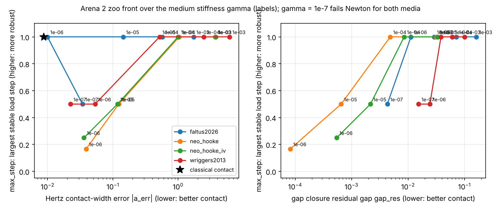

# Arena 2 zoo front (Phase 6 step 5, 2026-11-03, cloud session, judge contact-v0.8.dev)

PLAN §14.7 asks whether the zoo shows the trade-off in the medium's stiffness scale γ: a softer medium leaks less
force before contact and leaves less residual gap, but Newton becomes less robust. If it does not, Phase 7 has no
target and Arena 2 stops here (plan Gate 6 item 4).

**Result: the trade-off exists, and the widened zoo shows two axes of it.**
- *Within each medium* (over γ): as γ falls, leak and Hertz error fall by orders of magnitude while Newton cost rises
  and the largest stable load step falls; the neo-Hookean media fail at γ = 1e-7.
- *Across media* (robustness against residual gap): the two newer media (faltus2026, wriggers2013) stay robust much
  further. faltus2026 at γ = 1e-6 is as accurate in Hertz as the judge's error floor (a_err +1.0 %) and converges in a
  single load step; wriggers2013 still converges at γ = 1e-7. They pay with a residual gap in gap closure of 1–4 %
  (neo-Hookean: 0.001–0.07 % at the same γ).
- Classical frictionless contact (no medium) sits in the ideal corner: no leak, no residual gap, accurate to the
  error floor, one load step. No zoo medium reaches it on all axes at once.

Widening the zoo mattered: a Target D drawn from the neo-Hookean media alone would have been beaten outright by the
published 2026 medium.

Measured with `scripts/contact_front.py` (judge functions, dev-mesh cases, not registered runs; data in
docs/judge/baseline/contact_front.json; registered zoo runs are in STATUS). C0a: gap closure (confined). C2: Hertz on
the dev mesh with the judge's fixed regularization kr = 5e-7. max_step: 1 / fewest of 1, 2, 3, 4, 6, 8, 12 equal load
steps in which C2 converges.

| Medium | γ | C0a leak_pre | C0a gap_res | C2 a_err | C2 p0_err | C2 leak_out | C2 Newton iterations | max_step |
|---|---|---|---|---|---|---|---|---|
| faltus2026 | 1e-03 | 3.30e-02 | 1.62e-01 | +1.723 | -0.2855 | 0.178 | 51 | 1.000 |
| faltus2026 | 1e-04 | 3.72e-03 | 7.13e-02 | +0.572 | -0.1328 | 0.064 | 51 | 1.000 |
| faltus2026 | 1e-05 | 3.77e-04 | 2.90e-02 | +0.144 | -0.0513 | 0.043 | 56 | 1.000 |
| faltus2026 | 1e-06 | 3.78e-05 | 1.13e-02 | +0.010 | -0.0151 | 0.019 | 62 | 1.000 |
| faltus2026 | 1e-07 | 3.78e-06 | 4.30e-03 | -0.034 | -0.0004 | 0.012 | 77 | 0.500 |
| neo_hooke | 1e-03 | 1.87e-02 | 3.16e-02 | +3.702 | -0.2194 | 0.206 | 47 | 1.000 |
| neo_hooke | 1e-04 | 1.94e-03 | 4.85e-03 | +1.038 | -0.0374 | 0.056 | 56 | 1.000 |
| neo_hooke | 1e-05 | 1.95e-04 | 6.53e-04 | +0.123 | +0.0012 | 0.016 | 62 | 0.500 |
| neo_hooke | 1e-06 | 1.95e-05 | 8.23e-05 | -0.039 | +0.0085 | 0.011 | 87 | 0.167 |
| neo_hooke | 1e-07 | 1.95e-06 | 9.95e-06 | fails | — | — | — | 0.000 |
| neo_hooke_iv | 1e-03 | 1.42e-02 | 3.32e-02 | +3.751 | -0.1793 | 0.179 | 50 | 1.000 |
| neo_hooke_iv | 1e-04 | 1.45e-03 | 8.54e-03 | +1.000 | -0.0329 | 0.044 | 56 | 1.000 |
| neo_hooke_iv | 1e-05 | 1.45e-04 | 2.16e-03 | +0.118 | -0.0006 | 0.015 | 69 | 0.500 |
| neo_hooke_iv | 1e-06 | 1.45e-05 | 5.44e-04 | -0.036 | +0.0065 | 0.011 | 76 | 0.250 |
| neo_hooke_iv | 1e-07 | 1.45e-06 | 1.37e-04 | fails | — | — | — | 0.000 |
| wriggers2013 | 1e-03 | 5.89e-02 | 1.00e-01 | +6.132 | -0.4306 | 0.421 | 45 | 1.000 |
| wriggers2013 | 1e-04 | 6.46e-03 | 6.07e-02 | +2.462 | -0.1003 | 0.089 | 57 | 1.000 |
| wriggers2013 | 1e-05 | 6.53e-04 | 3.84e-02 | +0.519 | -0.0348 | 0.025 | 61 | 1.000 |
| wriggers2013 | 1e-06 | 6.53e-05 | 2.44e-02 | +0.053 | -0.0155 | 0.014 | 68 | 0.500 |
| wriggers2013 | 1e-07 | 6.54e-06 | 1.54e-02 | -0.023 | -0.0060 | 0.011 | 74 | 0.500 |
| classical | — | 0.00e+00 | 0.00e+00 | +0.009 | -0.0047 | 0.000 | 37 | 1.000 |

## The zoo and its sources

| Member | Source | State |
|---|---|---|
| `neo_hooke` | compressible neo-Hooke scaled by γ, the isotropic medium of Bluhm, Sigmund and Poulios (2021) | in the zoo |
| `neo_hooke_iv` | felupe's isochoric–volumetric neo-Hooke form; a FElupe variant, not claimed as a published third-medium formulation | in the zoo |
| `wriggers2013` | Wriggers, Schröder and Schwarz (2013), transversely isotropic medium, **as implemented in felupe's example ex20** (felupe v9 docs, provided by Peter); the paper itself was not available. Its anisotropic invariant equals the smallest principal squared stretch, so it is a function of C | in the zoo |
| `faltus2026` | Faltus, Amato and Horák (2026, arXiv 2603.13063) Eq. (1)–(2), the squared isochoric term as printed, κ_char = λ + 2μ/3; the paper's linear-elastic pre-contact term needs F and does not fit the slot | in the zoo |
| classical penalty contact | felupe ContactRigidPlane; not a medium, the reference corner | in the front |
| mixed formulation | Vorwerk, Schröder and Wriggers (CMAME 463, 2027; felupe ThirdMediumContactMixed): a regularization alternative (extra field θ ≈ H), not a medium | for the regularization slot, not this front |
| deformation-gradient averaging, ∇Q/∇R/∇φ/DivF/∇F_skw/∇J penalties | Faltus et al. 2026 and works cited there: regularizations | for the regularization slot |
| friction model | Target E, deferred (D4) | not in Phase 6 |

Target D (step 6) is pre-registered from this front. It should rest on a_err and p0_err (mesh-stable,
contact_spec.md §mesh_sens), max_step, and gap_res, and it must beat the best zoo medium on the axis it claims
without losing on the others: the new axis (robustness against residual gap) is where the zoo itself already spreads.
