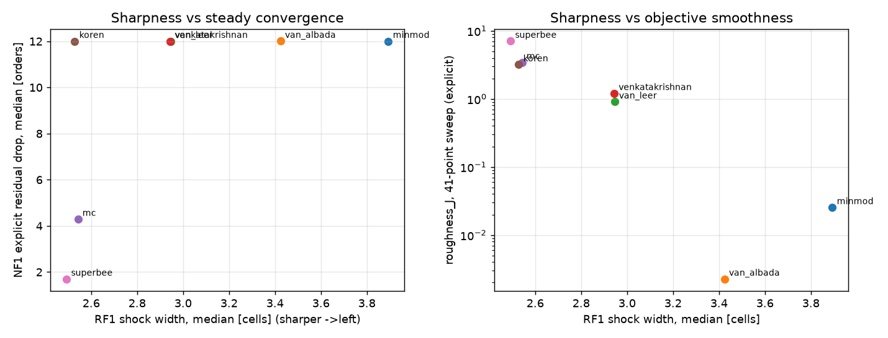

# Arena 1 baseline: does the problem exist? (PLAN §9.9)

Judge `euler1d-v0.dev` (untagged, Phase 1). Zoo members run through `sforge eval` exactly like candidates:
limiters with MUSCL + HLLC, fluxes with MUSCL-van Leer, reconstructions with HLLC. Sources: `sforge zoo eval
--suite dev|promo` (runs/reports/, registry), `scripts/promo_table.py` (held-out family aggregates — no
instance data), and `scripts/euler1d_baseline.py` (41-point back-pressure sweep on the Anderson nozzle with both
pseudo-time solvers; data in `baseline/sweep41.json`, plot `baseline/front.png`).

## 1. Which limiters stall?

Held-out NF1 (20 nozzles with a shock, random geometry, γ and sub-cell shock position), N = 120:

| limiter | explicit orders median / p90 / worst | implicit converged (share) | Newton steps median |
|---|---|---|---|
| van Albada | 12 / 12 / 2.9 | 1.00 | 110 |
| minmod | 12 / 11.2 / 3.0 | 1.00 | 114 |
| van Leer | 12 / 2.0 / 1.8 | 1.00 | 115 |
| Venkatakrishnan (K = 0) | 12 / 2.3 / 1.8 | 1.00 | 118 |
| Koren | 12 / 1.5 / 1.2 | 0.00 | 300 (cap) |
| MC | 4.3 / 1.8 / 1.5 | 0.00 | 300 (cap) |
| superbee | 1.7 / 0.8 / 0.5 | 0.00 | 300 (cap) |

41-point sweep on the Anderson nozzle (shock moved over 30 cells), share of back pressures that converge to 1e-12:

| limiter | explicit | implicit |
|---|---|---|
| van Albada | 1.00 | 1.00 |
| minmod | 0.00 (median 8.2 orders) | 1.00 |
| van Leer | 0.80 | 1.00 |
| Venkatakrishnan | 0.80 | 1.00 |
| MC | 0.73 | 0.49 |
| Koren | 0.73 | 0.39 |
| superbee | 0.27 | 0.00 |

- The three sharp limiters (superbee, MC, Koren) never converge with Newton on held-out nozzles: their kinks
  make the Jacobian discontinuous at the shock. Explicitly, superbee and MC stall; Koren converges in the median
  but stalls in the worst 10 %.
- van Leer and Venkatakrishnan converge with Newton but stall explicitly in at least 10 % of cases (limit cycles).
- minmod stalls explicitly on the Anderson sweep (8 orders) but converges on most NF1 instances.
- Only van Albada (a smooth function of r for r > 0, no kinks) converges with both solvers almost everywhere.

## 2. Shock width and overshoot

Held-out RF1 (20 random Riemann problems, N = 200), medians (p90):

| limiter | shock width [cells] | contact width [cells] | overshoot |
|---|---|---|---|
| superbee | 2.49 (3.13) | 4.58 (5.37) | 0.0069 (0.11) |
| Koren | 2.53 (3.66) | 6.37 (7.07) | 0.0044 (0.094) |
| MC | 2.54 (3.71) | 6.12 (7.35) | 0.0036 (0.088) |
| van Leer | 2.95 (4.37) | 7.12 (8.62) | 0.0017 (0.042) |
| Venkatakrishnan | 2.94 (4.49) | 7.58 (9.12) | 0.0014 (0.041) |
| van Albada | 3.42 (5.31) | 8.42 (10.1) | 0.0006 (0.022) |
| minmod | 3.89 (6.71) | 10.7 (12.8) | 0.0008 (0.016) |

Steady nozzle shocks are captured in about 1.6–1.8 cells by every limiter (NF1 median), so sharpness is decided on
moving discontinuities and contacts, not on the steady shock itself.

## 3. Roughness of the objective

J = axial force on the divergent wall, as a function of the back pressure (`roughness_J`, lower is smoother):

| limiter | NF3 median (p90) — 11 points, implicit | Anderson 41 points, explicit | Anderson 41 points, implicit |
|---|---|---|---|
| minmod | 0.00034 (0.00087) | 0.025 | 0.0026 |
| van Albada | 0.0011 (0.0015) | 0.0023 | 0.0023 |
| van Leer | 0.0012 (0.0018) | 0.90 | 0.0030 |
| Venkatakrishnan | 0.0012 (0.0018) | 1.2 | 0.0028 |
| superbee | 7.1 (21) | 7.1 | 127 |
| MC | 9.9 (20) | 3.4 | 199 |
| Koren | 14 (20) | 3.2 | 432 |

Sharp limiters give objectives that are 10³–10⁵ times rougher; for van Leer and Venkatakrishnan the roughness
depends on the solver (explicit limit cycles leave an unconverged, noisy J).

## 4. The front

Left: sharpness (RF1 shock width) against steady convergence (NF1 explicit residual drop). Right: sharpness
against objective smoothness (41-point sweep, explicit). No zoo limiter is both sharp (shock width ≲ 2.6 cells,
contact ≲ 6.5 cells) and convergent/smooth; the smooth ones pay 0.5–1.4 cells of shock width and 2–6 cells of
contact width.

## 5. Recommendation for Targets A and B

**Target A stands.** The zoo front is wide: the sharp limiters stall and give rough objectives, the smooth ones
smear. The gap to close is roughly: superbee/Koren-like sharpness (RF1 shock width ≤ 2.6 cells median,
contact ≤ 6.5) with van Albada-like convergence (NF1 explicit to 1e-12 in ≥ 95 % of instances, Newton
converging everywhere) and roughness_J ≤ 0.002. Proposed thresholds for docs/targets/A.md (Peter to confirm):
- RF1 shock width median ≤ 2.6 cells and contact width median ≤ 6.5 cells (MC/Koren level);
- NF1: explicit converged in ≥ 95 % of instances, implicit converged in 100 %;
- NF3 roughness_J p90 ≤ 0.002 (van Albada level);
- order_smooth (S1) ≥ 1.9; RF1/RF2 overshoot p90 no worse than van Leer.

**Target B** (well-balanced operator): not assessed yet — it needs the `operator` slot and the well-balanced
zoo baseline (Kröner & Thanh). The NF2 numbers in §6 show how far the simple source term is from
well-balanced on smooth steady flow: mass-flow errors of 5–14 % (median) at N = 120 for the MUSCL schemes.
Recommendation: build the `operator` slot and its well-balanced baseline at the start of Phase 3 and set the
Target B thresholds from that baseline, not now.

## 6. Other observations

- Roe + Harten fix violates positivity on R2 (123 problem) and on 2 of 20 RF1 instances (Einfeldt et al. 1991);
  dropped from the zoo at Gate 1 (Peter, 2026-10-20).
- Rusanov stalls explicitly on NF1 (median 2.2 orders): flux dissipation, not just the limiter, matters for
  steady convergence.
- WENO5-Z: sharpest on moving discontinuities (RF1 shock 2.35, contact 4.3 cells) but RF2 (slowly moving shocks)
  tv_increase median 1.3, and Newton fails in ≥ 10 % of NF1 instances.
- NF2 (10 shock-free nozzles, half unchoked subsonic with throat Mach 0.3–0.9, half with supersonic exit),
  median (p90):

  | scheme | mdot_var | l1_smooth | Newton converged | Newton steps |
  |---|---|---|---|---|
  | minmod | 0.048 (0.081) | 0.0060 (0.012) | 1.00 | 47 |
  | van Albada | 0.093 (0.14) | 0.013 (0.029) | 1.00 | 55 |
  | van Leer | 0.097 (0.19) | 0.018 (0.032) | 1.00 | 65 |
  | MC | 0.11 (0.23) | 0.022 (0.039) | 1.00 | 97 |
  | Koren | 0.14 (0.31) | 0.022 (0.040) | p90 fails | 126 |
  | superbee | 0.11 (0.20) | 0.012 (0.025) | 0.00 | 300 (cap) |
  | first order | 0.71 (0.79) | 0.067 (0.099) | 1.00 | 152 |

  The unchoked cases have exit Mach 0.04–0.2, where upwind dissipation is large (first order loses 70 % of the
  mass flow at N = 120). Superbee does not converge with Newton even without a shock (kinks at smooth extrema).
- How the judge got here: the first zoo runs exposed four judge artifacts, all fixed and reproduced with a test
  seed, never with held-out instances: shocks escaping through the nozzle exit (pressure outlet + subsonic-exit
  initial guess), unresolved jumps scored as infinitely wide (resolved-jump rule), NF2 instances with exit
  Mach ~0.02 (throat-Mach parameterization), and low-Mach cases that did not converge from the linear initial
  guess (subsonic initial guess). See git history and spec §5.3, §7.
