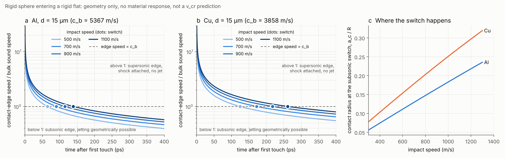
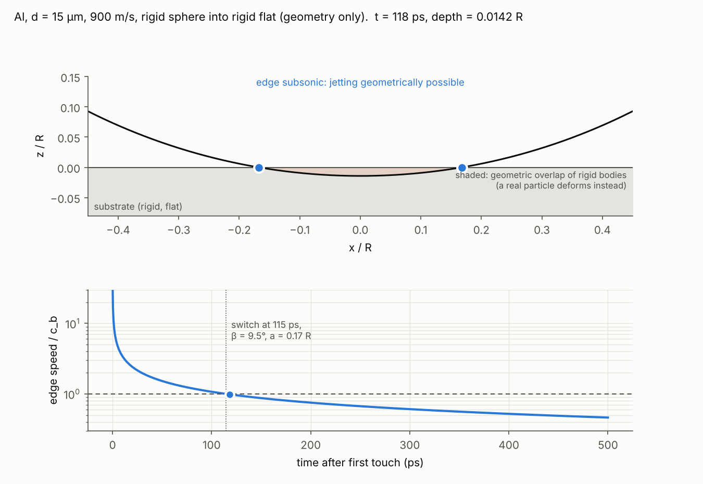

# Cold spray: geometric (kinematic) view of a normal particle impact

2026-11-07. **Geometry only:** a rigid sphere entering a rigid flat at constant speed. No material response, no
deformation, no shock physics beyond comparing one speed with another. **Not a v_cr prediction, not a hunch, not a
judge run.** Code: `src/schemeforge/research/impact_kinematics.py` (tests: `tests/test_impact_kinematics.py`). Figures:
`scripts/plot_kinematics.py` → `docs/research/figures/kinematics/`.

## What is computed

A sphere of radius R moves at speed V into the plane z = 0. Its penetration depth is δ = V t.

| Quantity | Formula |
|---|---|
| contact radius | a = √(2Rδ − δ²) |
| edge collision angle β (sphere surface against the plane at the contact edge) | cos β = (R − δ)/R, sin β = a/R |
| contact-edge speed | u = da/dt = V (R − δ)/a = V cot β |
| switch to a subsonic edge (u = c) | tan β_c = V / c |

**c is the bulk sound speed √(B/ρ),** from Table S1 by rule P1: Al 5367 m/s, Cu 3858 m/s.

The comparison of u with c is the simplified jetting condition of Walsh et al. (1953), as applied to the sphere by
Hassani-Gangaraj et al. (2018):
- while the contact edge moves faster than the sound speed, the shock stays attached to it and no material can
  escape ahead of it;
- once the edge is subsonic, material can squirt out at the edge, i.e. jetting becomes possible.

The tests check every formula in closed form:
- a² + (R − δ)² = R²;
- u equals the numerical derivative of a(t);
- u = V cot β;
- u = c exactly at the switch;
- the small-angle limit t_c → R V/(2c²).

## Numbers (d = 15 µm; every length scales with R, every time with R/V)

| Material | V (m/s) | β_c | a_c / R | δ_c / R | t_c | t_c / (D/V) |
|---|---|---|---|---|---|---|
| Al | 500 | 5.3° | 0.093 | 0.0043 | 65 ps | 0.0022 |
| Al | 700 | 7.4° | 0.129 | 0.0084 | 90 ps | 0.0042 |
| Al | 900 | 9.5° | 0.165 | 0.0138 | 115 ps | 0.0069 |
| Al | 1100 | 11.6° | 0.201 | 0.0204 | 139 ps | 0.0102 |
| Cu | 500 | 7.4° | 0.129 | 0.0083 | 124 ps | 0.0042 |
| Cu | 700 | 10.3° | 0.179 | 0.0161 | 172 ps | 0.0080 |
| Cu | 900 | 13.1° | 0.227 | 0.0262 | 218 ps | 0.0131 |
| Cu | 1100 | 15.9° | 0.274 | 0.0383 | 261 ps | 0.0192 |

Animation: `figures/kinematics/contact_al900.gif`. The contact edge is orange while it is supersonic and blue once
it is subsonic. The shaded cap is the geometric overlap of the two rigid bodies; a real particle deforms instead.

## What the picture shows (readings, no verdicts)

1. **Geometry gives no threshold velocity.** At every impact speed the edge starts infinitely fast and becomes
   subsonic within a few hundred picoseconds. So the jetting *condition* is always met eventually. Whether a jet
   forms, and whether the particle bonds, depends on what the material does at that moment: pressure against
   strength, or the interface state (CS-12). That part is not geometry.
2. **A reading of the sound-speed law Z6 (post hoc, not a test).** β_c depends only on V/c. A law of the form
   v_cr = α c therefore says that bonding needs the edge to go subsonic at one fixed contact angle, the same for
   every material: atan(α). For Z6 (α = 0.15) that angle is 8.5°.
3. **The switch is early and small.** It comes at 0.2–2 % of the transit time D/V and at a contact radius of
   0.09–0.27 R. The OpenCourant runs stopped on mesh collapse at the contact edge at:
   - 0.068–0.170 D/V: CS-11 setup F, `opencourant/results/cs11_sweep.csv`, column `t_stop_over_D_V`, all 23 rows;
   - 0.038–0.160 D/V: CS-13c, `opencourant/results/cs13c_pass1.csv`, all 27 runs.

   The latest switch in the table is at 0.019 D/V, so every one of those runs passed the switch before failing.
   These are solver diagnostics recorded in opencourant-verification.md §10 and §13, not judge runs. At R/32 the
   switch radius spans about 3–9 element spacings (0.093–0.274 R against a spacing of R/32).
4. **Cu switches later and at a larger radius than Al** at the same speed, because its sound speed is lower.

## Limits

- **Rigid bodies.** A real particle and substrate deform. The contact grows faster than the rigid estimate, so the
  edge slows sooner and the real switch comes earlier and at a smaller depth than in the table.
- **Simplified jetting condition.** Walsh's criterion compares the collision-point speed with the sound speed of
  the compressed material and allows jetting above a critical angle even for a supersonic collision point. The
  ambient bulk sound speed is used here. The Hugoniot intercept C₀ would change the numbers by a few percent.
- **No size effect.** All lengths scale with R and all times with R/V. Any size dependence of v_cr must come from
  material physics (rate, heat conduction, oxide; see CS-10, CS-13), not from this geometry.
