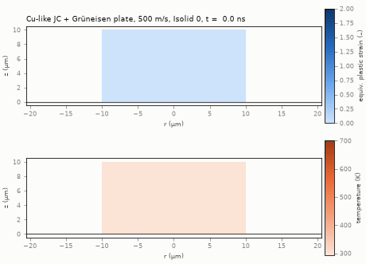
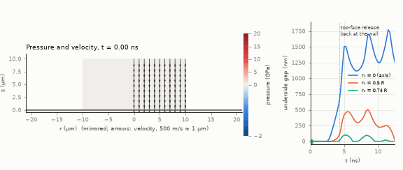
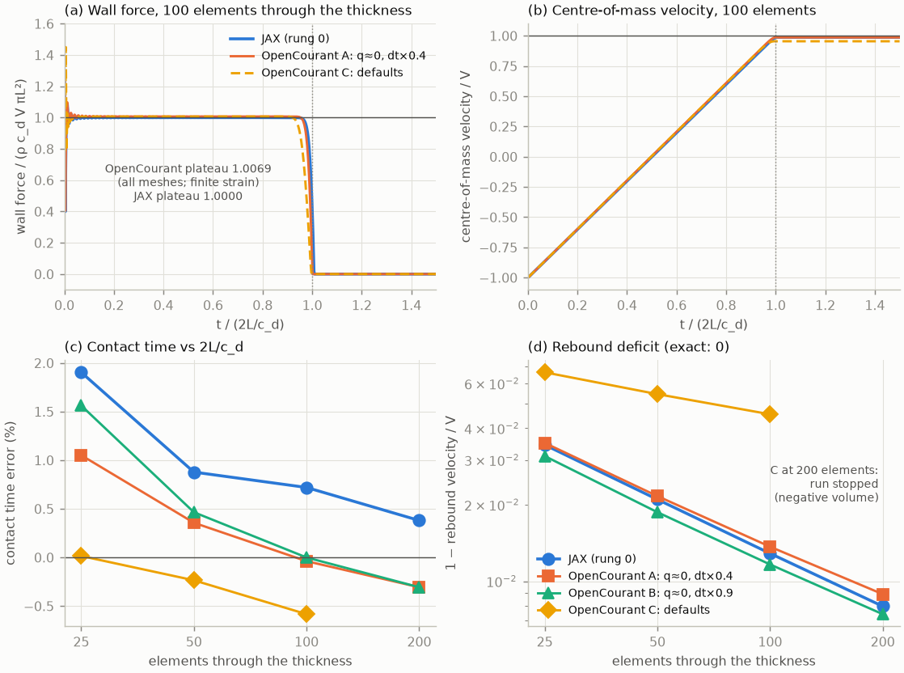
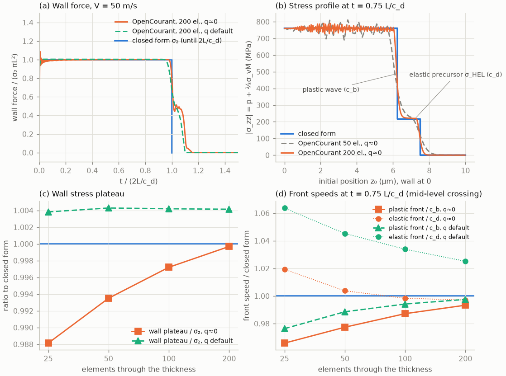
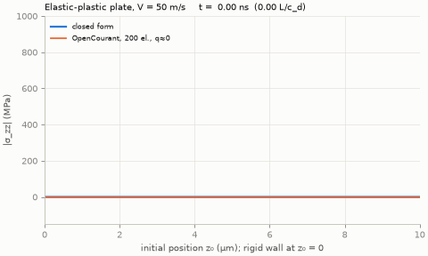
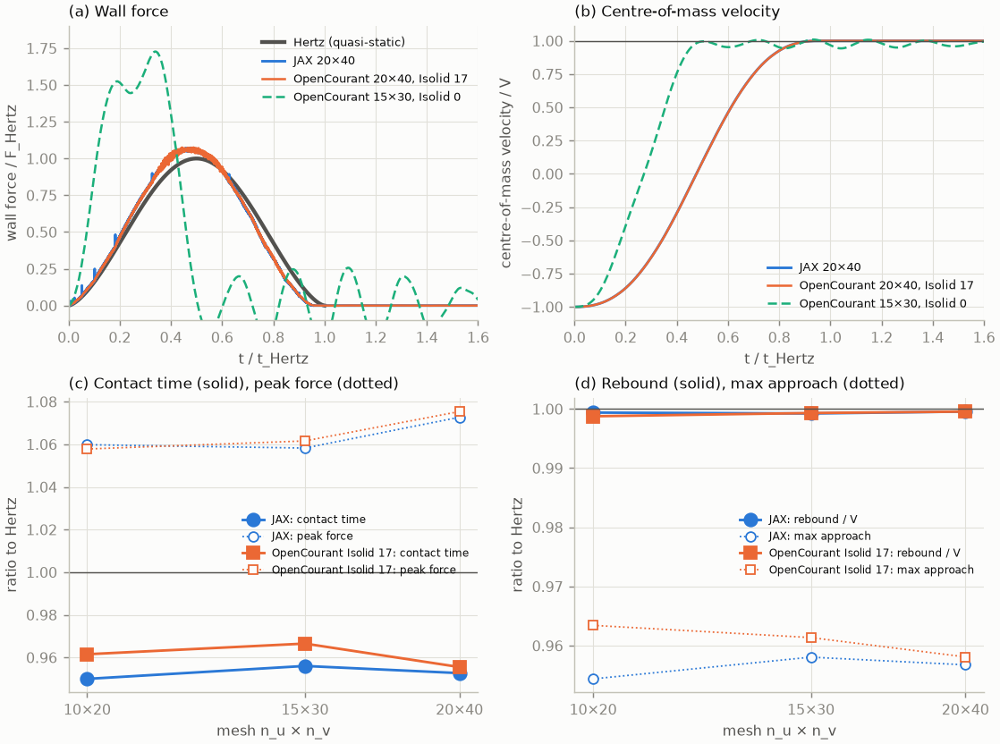
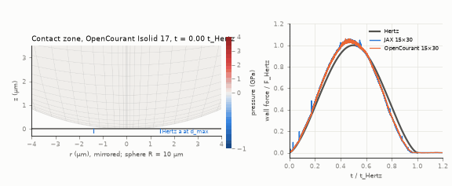
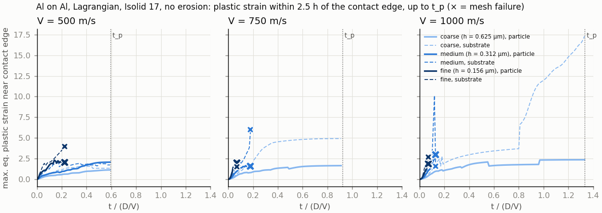
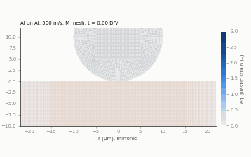

# OpenCourant verification: feature check and rung 0 (elastic, elastic-plastic)

Sessions of 2026-11-03 and 2026-11-04 (rung 1, element formulation, temperature checks). Solver: OpenCourant `latest-20261011` (commit `cb760c2`), local install, 1 process,
1 thread ([openradioss-setup.md](openradioss-setup.md)). Decision context: DECISIONS 2026-11-03 "Main impact
solver: OpenCourant instead of OpenRadioss". Peter's order: option 1 (JC + Grüneisen in 2D axisymmetric), then
option 2 (rung 0 against the exact solution and the JAX code), then the elastic-plastic 1D case in OpenCourant
only. Option 4 (Taylor validation) is on hold.

All decks are our own, written by [`opencourant/scripts/ocdeck.py`](opencourant/scripts/ocdeck.py) from the card
formats in the shipped keyword configuration (`hm_cfg_files`) and the Radioss 2022 Reference Guide (RG). No QA deck
is used or copied.

## Summary

| Question | Answer |
|---|---|
| JC + Mie–Grüneisen on axisymmetric quads? | **Yes.** `/MAT/LAW4` + `/EOS/GRUNEISEN` on `/QUAD` with N2D3D = 1 is accepted and runs; confined and unconfined plates at 500 m/s; pressure peak −4 % of the Hugoniot estimate. |
| Adiabatic heating? | **LAW4's built-in temperature is exactly plastic-work heating** (ΔT = ∫σ_y dε_p/ρc_p, checked to 0.4 % with a constant yield stress, §2.1), **plus** bulk-viscosity work when q is on, **plus** reversible compression heating when `/EOS/GRUNEISEN` is used. **`/HEAT/MAT`** gives T ≈ 0 on axisymmetric quads (unusable in 2D). On 3D bricks it works but **ignores EFRAC** for LAW4 (0.9 and 0.5 give the same T), so a Taylor–Quinney fraction β needs ρc_p/β instead. |
| Rung 0 (elastic) against the exact solution? | **Agrees.** Contact time error +1.05/+0.36/−0.04/−0.31 % and rebound 0.965/0.978/0.986/0.991 V at 25/50/100/200 elements (`Isolid = 17`) (variant A, closest to the JAX settings). JAX: +1.9/+0.9/+0.7/+0.4 %, 0.966/0.979/0.987/0.992 V (reproduced here). |
| Plateau force | **+0.69 % at every mesh**: a finite-strain effect, ≈ 0.42 × V/c_d, which vanishes as V → 0. Quads have no small-strain option (starter error 1223). JAX is linear and exact. |
| Rung 0p (elastic-plastic two-wave) | **Agrees with the closed form** with q ≈ 0: wall stress σ₂ to 0.9997 at 200 elements, plastic front speed 0.993 c_b, elastic front 0.997 c_d; ε_p behind the plastic wave 1.05 (q ≈ 0) and 0.986 (default q) of the closed form. |
| **Axisymmetric element** | **Use `Isolid = 17`** (4-point quad). The default 2D solid is area-weighted. It fails the Hertz sphere (about 5 × too stiff, mesh-independent) and loses axial momentum in free flight; it passes only the 1D cases. With `Isolid = 17` OpenCourant agrees with the JAX code on the unconfined disc (to 0.004 V) and on the Hertz sphere (to about 1 %). **Lagrangian only**: with ALE the starter falls back to the area-weighted element (§5.4). §5 |
| Rung 1 (Hertz sphere) | **Agrees with the JAX code** (contact, peak, approach and rebound within about 1 % at 10 × 20, 15 × 30, 20 × 40). Both are 4–5 % short of quasi-static Hertz at 20 m/s and approach it at lower speed (dynamic effect). |
| Jet distortion (open item 8) | **SPH is 3D-only** (source: no N2D use, 3D kernel only). **No Lagrangian remeshing for `/QUAD`** (`/ADMESH` is shells only). **Option 1 (Lagrangian, `Isolid = 17`, Al–Al, 500–1000 m/s):** the mesh fails at the jet root at 5–37 % of the penetration time on the finest mesh, earlier with refinement; edge quantities are not converged (rerun with sourced γ₀ = 2.17: same conclusion). A bonding criterion cannot be evaluated before failure. §8 |
| Pitfalls found | (1) The rigid-wall force output `FNZ` is ∫σ dr, not a force, in axisymmetric runs. (2) Default quadratic bulk viscosity + default time-step scale goes unstable (zero volume at cycle 0) on 50:1 quads. (3) Default bulk viscosity costs 5–7 % rebound velocity in the elastic case. (4) Axisymmetric time-history internal energy (and the ERR % energy-balance column) reads zero: energy balance cannot be checked from it. (5) With `Isolid = 17` the temperature is computed but not written out. |

## 1. Method

**Geometry and boundary conditions** (`ocdeck.write_plate_deck`).
- SI units (`/BEGIN` kg m s, deck version 2026). `/ANALY` N2D3D = 1. Quads in the YZ plane: Y = r, Z = axis.
- Plate 0 ≤ r ≤ R, 0 ≤ z ≤ L, uniform mesh, `/PROP/TYPE14` with `Isolid = 17` (4-point quad; the default element fails rung 1, §5).
- Frictionless rigid plane `/RWALL/PLANE` (Slide = 0) at z = 0, normal +z, all nodes as secondary nodes.
- `/INIVEL` −V on all nodes, so the plate starts in contact.
- `/BCS` fixes u_r (and x) on the axis. For the confined cases it fixes u_r on all nodes. The starter then reports warning 312, "incompatible kinematic conditions", for the nodes that carry both `/BCS` and the wall; the elastic results below show no effect.

**Output.** Axisymmetric time-history quantities are **per radian**: `MASS` = ρL³/2 to machine precision, versus
ρπL³ for the full ring.
- The wall force is taken as F = 2π·d(ZMOM)/dt from the part time history, written every cycle (`/TFILE` below the time step). The wall is the only axial force, so this is exact up to the 7 printed digits.
- **Finding:** the `/TH/RWALL` column `FNZ` equals −∫σ_zz dr, measured as −1.0066·σR at R = L and 2L and n_r = 4 and 8 (`Isolid = 0`; −1.0069·σR with `Isolid = 17`). It is not a force per radian (which would be σR²/2). Do not use the rigid-wall time-history force in 2D axisymmetric runs without this conversion; it is only valid for uniform σ.

**Metrics (rung 0)**, identical to `tests/test_impact_axisym.py`:
- **plateau:** mean force over 0.2–0.8 t_c divided by ρc_dVπL²;
- **contact:** last time with F > 10⁻⁹ F_exact, divided by t_c = 2L/c_d;
- **rebound:** centre-of-mass velocity at t = 3L/c_d, divided by V.

**Variants** (`rung0.py`):

| Variant | Bulk viscosity q_a, q_b | Time-step scale (`/DT`) | Comment |
|---|---|---|---|
| A | 10⁻³⁰ (≈ 0) | 0.4 | closest to the JAX code (no viscosity, CFL 0.4) |
| B | ≈ 0 | 0.9 (default) | |
| C | defaults 1.10, 0.05 (RG p.1703–1704) | 0.9 | OpenCourant out of the box |

Reproduce: `python rung0.py <work_dir> <out.csv>`, `python rung0p.py <work_dir> <out.csv> <traces.npy>`, then
`plot_rung0.py` and `plot_rung0p.py`. All need numpy (plus matplotlib and pillow for plots) and the local install
path in `ocdeck.OC_ROOT`. Raw runs stay in the session scratchpad; result tables are in
[`opencourant/results/`](opencourant/results/).

## 2. Option 1: Johnson–Cook + Mie–Grüneisen + heating on axisymmetric quads

**Material:** nominal copper-like values, typed from memory and **not verified**. That is fine for a feature
check and they must not be used for results:
- E = 124 GPa, ν = 0.34, ρ = 8930 kg/m³;
- JC: A = 90 MPa, B = 292 MPa, n = 0.31, C = 0.025, ε̇₀ = 1 s⁻¹, m = 1.09, T_melt = 1356 K;
- ρc_p = 3.44 MJ/(m³K);
- Grüneisen: c₀ = 3940 m/s, S₁ = 1.49, γ₀ = 1.99.

Plate L = R = 10 µm, V = 500 m/s, default bulk viscosity.

| Run | Setup | Starter / engine | Result |
|---|---|---|---|
| J1 | LAW4 + GRUNEISEN, confined, 50 × 4 | accepted (only warning 312); normal termination, 627 cycles | Listing echoes "JOHNSON COOK LAW" and "MIE-GRUNEISEN EOS". Peak cell pressure 19.8 GPa vs ρ₀(c₀ + S₁V)V − ⅔σ_y ≈ 20.6 GPa (−4 %, frames every 0.25 ns). ε_p max 0.30. **T: 293 K → 880 K peak** (during compression), 705 K at 15 ns. |
| J2 | as J1 + `/HEAT/MAT` (EFRAC 0.9) | accepted; listing echoes T0 = 293, ρc_p, "FRACTION OF STRAIN ENERGY CONVERTED INTO HEAT = 0.9"; normal | **T ≈ 10⁻⁸ K everywhere** |
| J3 | as J2, unconfined, 50 × 10 | normal, 2290 cycles | ε_p max 1.92; T ≈ 10⁻⁹ K |
| J4, J5 | J2, J3 + engine `/THERMAL` | normal; engine prints "FINITE ELEMENT THERMAL ANALYSIS … TEMPERATURE (SOLID ONLY)" | T starts at 0 (T₀ not applied), max ≈ 10⁻⁸ K |
| J6 | J4 with conductivity AS = 400 W/(m K) | normal | unchanged, T ≈ 10⁻⁸ K |
| J7 | LAW4 + GRUNEISEN, no `/HEAT/MAT`, unconfined, 50 × 50 | normal, 1.0 s engine time | GIF below: ε_p max 1.89, T max 693 K at 12.5 ns |

`/HEAT/MAT` notes:
- The 2022+ card format has no `Iform` field. RG p.1223–1224 says `Iform = 0` (finite volume) is for ALE solids and `Iform = 1` for Lagrangian solids and shells.
- The engine's "(SOLID ONLY)" message suggests 2D quads are not covered.
- Not resolved. Next test: the same card on 3D bricks.
- Until then, the only working temperature path in 2D is LAW4's built-in adiabatic update. That takes T from the element internal energy, including reversible compression energy (hence the 880 K peak and drop to 705 K on release), and offers no Taylor–Quinney fraction.

*Unconfined plate, 500 m/s, mirrored about the axis, default element (`Isolid = 0`). With the verified element
(`Isolid = 17`) the deformation is nearly the same (§2.2), but its temperature is not written out (§5.3). Feature
check only; the material values are nominal.*

### 2.1 What the LAW4 temperature contains (exact check)

The source sets the update (`engine/source/materials/mat/mat004/m4law.F`, lines 223–239, commit `cb760c2`):
- **without thermal analysis:** `TEMPEL = TEMPEL + SIGY*DPLA/RHOCP`, i.e. plastic work with factor 1;
- **with thermal analysis on a Lagrangian mesh:** `FHEAT = FHEAT + SIGY*DPLA*VOL` as the heat source, with no EFRAC factor in that line.

Check: Johnson–Cook with B = C = 0 gives a constant yield stress A = 300 MPa, so each element must heat by exactly
A·ε_p/ρc_p. Confined plate (2D, 20 × 2) and confined brick column (3D, 20 bricks) at 500 m/s, time-step scale
0.4 ([`tcheck.py`](opencourant/scripts/tcheck.py), [`results/temperature_check.csv`](opencourant/results/temperature_check.csv)):

| Case | EOS | bulk viscosity | `/HEAT/MAT` | ΔT median (K) | A·ε_p/ρc_p (K) | ratio |
|---|---|---|---|---|---|---|
| 2D | none (LAW4 default) | ≈ 0 | – | 13.09 | 13.14 | **0.996** |
| 2D | none | default | – | 43.99 | 7.37 | 5.97 |
| 2D | Grüneisen | ≈ 0 | – | 91.50 | 14.69 | 6.31 |
| 2D | Grüneisen | default | – | 129.65 | 6.74 | 19.2 |
| 3D | none | ≈ 0 | – | 12.97 | 13.02 | **0.996** |
| 3D | Grüneisen | ≈ 0 | – | 91.83 | 14.15 | 6.51 |
| 3D | none | ≈ 0 | EFRAC 0.9 (+ `/THERMAL`) | 12.90 | 13.01 | **0.998** |
| 3D | none | ≈ 0 | EFRAC 0.5 (+ `/THERMAL`) | 12.90 | 13.01 | **0.998** |

- **Plastic-work heating is exact** (to 0.4 %) when nothing else adds energy.
- **Bulk viscosity adds its dissipated work** to the temperature: 6× here. In a shock that is the irreversible jump the q term represents, but its size is set by q_a and q_b, not by the material.
- **The Grüneisen EOS adds compression heating:** +78 K at about 10 % compression with γ₀ = 1.99, of the order of T·γ·ΔV/V ≈ 60 K. It is reversible and falls on release (J1: 880 K peak, 705 K later).
- **EFRAC has no effect** with LAW4, consistent with the source line. In adiabatic runs, β·W/ρc_p can be obtained by entering ρc_p/β.
- **q ≈ 0 doubles ε_p** in this coarse shock (14.7 K vs 6.7 K of plastic heating), as in rung 0p: ringing behind the jump causes extra yielding.

For cold spray, the interface temperature is meant to come from plastic work. The other two parts should
therefore be either kept small (q small, at a fine mesh) or reported separately (EOS compression heating).

### 2.2 Why the centre lifts off the wall (run J7)

J7 is a squat disc (R = L = 10 µm) on a frictionless, non-adhesive rigid wall, with no failure model (Pmin =
−10³⁰). Underside gap and bottom-layer pressure, read by node ID from the 0.25 ns frames:

| t (ns) | gap at r₀ = 0 / 0.5R / 0.74R (nm) | bottom-layer p at r₀ = 0 / 0.24R / 0.5R / 0.74R (GPa) | outer radius (µm) |
|---|---|---|---|
| 0.5 | 0 / 0 / 0 | 19.7 / 19.7 / 19.7 / 19.4 | 10.4 |
| 1.5 | 0 / 0 / 0 | 19.7 / 19.5 / 10.4 / 4.4 | 11.4 |
| 2.5 | 0 / 0 / 0 | 0.2 / 2.9 / 2.0 / 1.3 | 12.4 |
| 3.0 | 99 / 0 / 0 | −0.4 / −0.5 / −0.2 / 0.6 | 12.9 |
| 4.5 | 846 / 186 / 39 | −1.5 / −1.5 / −1.0 / −0.3 | 14.2 |
| 5.0 | 1502 / 418 / 96 | 1.9 / 1.3 / 0.0 / −0.2 | 14.6 |
| 12.5 | 1249 / 3 / 0 | 0.0 / −0.5 / 1.5 / 0.9 | 19.5 |

1. **Impact shock (0–2 ns).** The face is loaded to about 19.7 GPa (Hugoniot estimate 20.6 GPa). The shock runs up the disc at U ≈ c₀ + S₁V ≈ 4.7 km/s. Behind it the material is at rest axially and compressed by about V/U ≈ 10 %.
2. **Lateral release from the free side face.** The cylinder's side is free, so a release fan runs inward from the edge. The bottom-layer pressure drops at 0.74R by 1 ns, at 0.5R by 1.5 ns, at 0.24R by 2 ns and on the axis by 2.5 ns (about 4 km/s inward). Behind it the material flows **outward along the wall** (arrows in the GIF): the rim pancakes and slides, so the outer radius grows from 10 to 19.5 µm. This ring stays on the wall because its motion is mostly radial.
3. **Focusing on the axis (≈ 2.5–3 ns).** The inward release meets itself on the axis and the pressure there goes negative. The highly compressed central column springs back (stored EOS compression and elastic energy) and pushes the underside up. **The centre leaves the wall at about 2.7 ns**, before the 1D picture would predict it: there, the release from the top face is back at the wall only at 2L/U ≈ 4.3 ns.
4. **Top-face release (≈ 4.3–4.5 ns).** It arrives and adds tension (−1.5 GPa in the bottom layer). The centre underside briefly moves up at about 1.2 km/s, and the gap reaches 1.5 µm at 5 ns.
5. **Afterwards** the thinned centre rings like a free plate: the gap swings between 1.1 and 1.8 µm with a period of about 3.5 ns. The rim (r₀ ≥ 0.74R) stays in or near contact and keeps sliding outward.

**Is it physical?** The mechanisms are: shock, release from the free edge, cylindrical focusing on the axis, and
springback of the compressed core. These are ordinary wave mechanics, and the axis is where the release waves from
all around the edge meet. For this idealised problem, then, a central gap with the rim still sliding is the
expected answer, not a solver artefact.

What is idealised or not converged:
- **No adhesion.** Any tension at the interface separates it. Real bonding would hold where bonded, which is exactly the cold-spray question.
- **Frictionless wall.**
- **No spall model.** The disc carries −1.5 GPa of tension; a failure model could open a spall plane instead.
- **Coarse mesh and default bulk viscosity.** 50 × 50 cells; the ringing amplitude and the 1.2 km/s spike are not mesh-converged.
- **Nominal material values.**
- **Geometry.** A real particle is a sphere, so contact grows from a point and the release comes from the moving contact edge, not from a fixed side face.

For orientation only (general knowledge, not checked in this session): single-particle cold-spray impacts are
often described with an unbonded centre and bonding in an outer ring. The same release-wave picture is the usual
explanation.

**Re-checked with `Isolid = 17` (§5).** The tables above come from the default element. Re-run with the 4-point
quad, the lift-off is essentially the same:
- the gap on the axis is 88 nm at 3 ns (99 before), 436 nm at 4 ns (492), 1360 nm at 5 ns (1502);
- the same pressure sequence;
- the outer radius is 18.6 µm at 12 ns (19.3).

The explanation stands. The GIF below is from the `Isolid = 17` run.

*Left: pressure (red compression, blue tension; scale −3 to 20 GPa), velocity arrows, mirrored. Right: underside
gap at three initial radii; the dotted line marks 2L/U, when the top-face release returns to the wall in 1D.*

## 3. Rung 0: elastic confined plate (comparison with the JAX code)

E = 70 GPa, ν = 0.35, ρ = 2700 kg/m³, L = R = 10 µm, n_r = 4, V = 100 m/s.
c_d = 6450.54 m/s, t_c = 2L/c_d = 3.1005 ns, F_exact = ρc_dVπL² = 0.54715 N.

JAX rows: `confined_plate_on_rigid_wall` rerun in this session (`uv run`, x64), identical to Peter's numbers.

| n_z | JAX plateau | JAX contact | JAX rebound | OC A plateau | OC A contact | OC A rebound | OC B contact | OC B rebound | OC C contact | OC C rebound |
|---|---|---|---|---|---|---|---|---|---|---|
| 25 | 1.0000 | 1.0190 | 0.9656 | 1.0069 | 1.0105 | 0.9650 | 1.0156 | 0.9689 | 1.0001 | 0.9336 |
| 50 | 1.0000 | 1.0088 | 0.9790 | 1.0069 | 1.0036 | 0.9784 | 1.0046 | 0.9813 | 0.9976 | 0.9455 |
| 100 | 1.0000 | 1.0072 | 0.9871 | 1.0069 | 0.9996 | 0.9863 | 1.0000 | 0.9884 | 0.9942 | 0.9546 |
| 200 | 1.0000 | 1.0038 | 0.9920 | 1.0069 | 0.9969 | 0.9911 | 0.9969 | 0.9926 | **stopped** | **stopped** |

All OpenCourant columns use `Isolid = 17` (§5). The full table, with KE ratio, `FNZ` and cycle counts, is in
[`results/rung0_opencourant.csv`](opencourant/results/rung0_opencourant.csv). Engine time ≤ 0.2 s per run.
The first runs with the default element (`Isolid = 0`) are kept in `rung0_opencourant_isolid0.csv`. In this
confined case they differ by at most 0.0006 (plateau 1.0066, rebound 0.9905 at 200 elements), because without
radial motion the two formulations nearly coincide.

**Findings**
- **Rebound velocity:** OpenCourant without viscosity (A, B) and JAX converge alike: deficit 3.5 → 2.2 → 1.4 → 0.9 % (JAX 3.4 → 2.1 → 1.3 → 0.8 %), a factor of about 1.6 per mesh doubling (order ≈ 0.7) in both. The two codes differ by ≤ 0.004 V at every mesh.
- **Contact time:** OpenCourant converges from above and crosses 2L/c_d at about 100 elements, ending at −0.3 % at 200. That fits the finite-strain stiffening below (the wave runs about 0.3 % faster at this strain); JAX stays above.
- **Plateau +0.69 % (+0.66 % with `Isolid = 0`), the same at every mesh, time step and viscosity.**

  | V (m/s) | strain V/c_d | plateau − 1 | ratio (plateau − 1) / strain |
  |---|---|---|---|
  | 1 | 1.6e-4 | +0.00006 | 0.40 |
  | 10 | 1.6e-3 | +0.00065 | 0.42 |
  | 100 | 1.6e-2 | +0.00659 | 0.43 |
  | 1000 | 0.155 | +0.0696 | 0.45 |

  (A settings, 100 elements, `Isolid = 0`.) The excess scales with the strain and vanishes as V → 0, so it is the
  finite-strain formulation, not an error. The exact solution and the JAX code are small-strain linear. At
  1000 m/s the contact time drops to 0.937 t_c for the same reason. Switching it off is not possible: `Ismstr`
  = 1, 10 or 11 on quads stops the starter with error 1223, "QUAD ELEMENT IS NOT COMPATIBLE WITH SMALL STRAIN
  OPTIONS". For cold spray (strains of order 1) this is the physics we want; for verification against linear
  solutions it sets a floor of about 0.4 ε.
- **Default bulk viscosity (C)** absorbs energy: the rebound deficit is 6.7 → 5.5 → 4.6 % at 25/50/100 elements, falling much more slowly than without viscosity. **At 200 elements (aspect ratio 50) it stops at cycle 0** with "ZERO OR NEGATIVE VOLUME FOR 2D-ELEMENT". Each of these avoids it: q_a ≈ 0, time-step scale 0.4, or n_r = 8 or 16 (aspect ≤ 25). The quadratic term is the trigger; q_a = 1.1 alone fails, q_b = 0.05 alone runs.

## 4. Rung 0p: elastic–perfectly-plastic confined plate (OpenCourant only)

Same plate, `/MAT/LAW2` with Y = 100 MPa, no hardening (b = 0), no rate or temperature terms. Uniaxial strain,
small-strain closed form (`rung0p.py`):
- σ_HEL = Y(1 − ν)/(1 − 2ν) = 216.7 MPa, carried by an elastic precursor at c_d = 6450.5 m/s; u_HEL = σ_HEL/(ρc_d) = 12.44 m/s.
- The plastic wave runs at c_b = √(K/ρ) = 5367.2 m/s; σ₂ = σ_HEL + ρc_b(V − u_HEL) = 761.0 MPa at V = 50 m/s.
- The wall stress is σ₂ from t = 0 until the release from the back face returns at 2L/c_d.
- ε_p behind the plastic wave = ⅔(V − u_HEL)/c_b = 0.00467 (uniaxial strain: dε_p = ⅔ dε_zz after yield).

The stress profile |σ_zz| = p + ⅔σ_vM is taken per element layer, against the initial position z₀, at
t = 0.75 L/c_d. That is before the precursor reaches the back face. Front positions are the mid-level crossings.
Time-step scale 0.4 throughout.

| V | n_z | q | wall plateau / σ₂ | profile σ₂ | profile σ_HEL | plastic front / c_b | elastic front / c_d | ε_p behind wave / closed form | rebound / V |
|---|---|---|---|---|---|---|---|---|---|
| 50 | 25 | ≈ 0 | 0.9881 | 0.9851 | – | 0.9659 | 1.0193 | 1.146 | 0.808 |
| 50 | 50 | ≈ 0 | 0.9935 | 0.9896 | 1.070 | 0.9774 | 1.0037 | 1.105 | 0.819 |
| 50 | 100 | ≈ 0 | 0.9972 | 0.9940 | 1.060 | 0.9872 | 0.9983 | 1.074 | 0.824 |
| 50 | 200 | ≈ 0 | **0.9997** | 0.9972 | 1.048 | **0.9933** | **0.9971** | 1.051 | 0.826 |
| 50 | 25 | default | 1.0038 | 1.0030 | – | 0.9763 | 1.0637 | 1.013 | 0.792 |
| 50 | 50 | default | 1.0043 | 1.0017 | 1.084 | 0.9886 | 1.0452 | 0.997 | 0.802 |
| 50 | 100 | default | 1.0042 | 0.9976 | 1.102 | 0.9942 | 1.0338 | 0.991 | 0.807 |
| 50 | 200 | default | 1.0041 | 0.9939 | 1.093 | 0.9975 | 1.0251 | 0.986 | 0.812 |
| 25 | 100 | default | 1.0020 | 0.9972 | 0.982 | 0.9828 | 1.0193 | 0.991 | 0.824 |
| 100 | 100 | default | 1.0087 | 0.9989 | 1.315 | 1.0037 | 1.0485 | 0.989 | 0.868 |
| 200 | 100 | default | 1.0179 | 1.0078 | 1.906 | 1.0163 | 1.0657 | 0.989 | 0.904 |

The table is in [`results/rung0p_opencourant.csv`](opencourant/results/rung0p_opencourant.csv). The rebound has
no closed form here; it is listed for later comparison with the JAX code once that has plasticity.

*Stress profile through the thickness, 200 elements, q ≈ 0, V = 50 m/s. Closed form drawn while it applies
(t ≤ L/c_d).*

**Findings**
- **Two-wave structure reproduced.** Wall stress, plastic wave speed and elastic front speed converge to the closed form with q ≈ 0 (to 0.03 %, 0.7 % and 0.3 % at 200 elements). The plastic strain behind the wave converges from above (+5 % at 200) because the ringing behind the jump causes a little extra yielding.
- **Default viscosity** smears the fronts: the elastic mid-level crossing runs 2.5–6 % ahead, the plateau sits at +0.4 %, and ε_p is within 1.5 %.
- **The σ_HEL shelf** measures 5–10 % high. At t = 0.75 L/c_d the shelf is only 0.126 L wide (12 elements at n = 100), and the ±3-element margins leave too few cells next to an overshooting front. This is a limit of the measurement, not a solver error: the GIF shows the shelf at the right level. At V ≥ 100 m/s the plastic front itself sits in the window, so the column means nothing there.
- **Velocity dependence** of the wall plateau (+0.2/+0.4/+0.9/+1.8 % at 25/50/100/200 m/s) and of the plastic front speed: finite strain again. The pressure-dependent bulk stiffness at finite strain is not in the small-strain closed form.

## 5. Rung 1: Hertz sphere, and the axisymmetric element formulation

### 5.1 What went wrong with the default element

The first rung-1 runs used the default 2D solid (`Isolid = 0`). The sphere came out far too stiff, independent
of the mesh:

| Isolid 0, 15 × 30 | approach / d_Hertz | time of max approach / t_Hertz | peak force / F_Hertz |
|---|---|---|---|
| from momentum (time history) | 0.518 | 0.272 | 1.73 |
| from node positions (animation) | 0.51 | ≈ 0.27 | – |
| 30 × 60 (time history) | 0.516 | 0.271 | 1.74 |

The hourglass coefficient changed nothing (h = 0, default and 0.1 give identical results). Two cross-checks
located the problem:
- **Slender elastic rod** (R = 5 µm, L = 100 µm, uniaxial stress, so radial and hoop terms matter): the plateau stress is ρc₀V to 0.2 %. So the element is right for smooth, nearly uniform fields.
- **Unconfined elastic disc** (R = L = 10 µm, 20 × 20, V = 20 m/s) against the JAX code on the identical mesh: the velocity and force histories agree for about one transit time. After that the default element **loses axial momentum in free flight**, from 0.55 V to 0.42 V, with no node in contact and no axial external force. The wall force read from momentum goes negative.

The source explains it. The default quad (`engine/source/elements/solid_2d/quad/`) is **area-weighted** in
axisymmetric runs:
- nodal mass `MASS = RHO*AREA*OFF*FOURTH`, with no radius factor (`qmass2.F`);
- plane-like area-gradient forces plus 1/r terms `AX1 = (σ_θθ − σ_rr)·A²/(4V)` and `AX2 = σ_rz·A²/(4V)` (`qfint2.F`, `qcumu2.F`);
- the time history reports real per-radian quantities from separate routines, which is why mass and momentum looked consistent at t = 0.

An area-weighted scheme does not conserve axial momentum, and it gets concentrated loads near the axis
wrong. Hertz contact at the pole is exactly that case. The confined plate (no radial motion) and the slender rod
(uniform fields) do not show it.

The force dispatcher (`engine/source/elements/forint.F`, line 1266) calls the 4-point quad `q4forc2` when
`JHBE == 17`, or `N2D == 1 .AND. JHBE == 22`, i.e. `Isolid = 17` in `/PROP/TYPE14`. In our decks `Isolid = 22` gave
the default element again. With **`Isolid = 17`**:

| Unconfined disc, t / (L/c_d) | 1.0 | 2.0 | 3.0 | 4.0 | 5.9 |
|---|---|---|---|---|---|
| v/V JAX | −0.1395 | 0.4938 | 0.5443 | 0.5592 | 0.5592 |
| v/V OpenCourant, `Isolid = 0` | −0.1122 | 0.5642 | 0.4891 | 0.4196 | 0.5125 |
| v/V OpenCourant, `Isolid = 17` | −0.1392 | 0.4973 | 0.5459 | 0.5611 | 0.5605 |

`Isolid = 17` agrees with JAX to 0.004 V and **conserves momentum in free flight** (0.560 ± 0.001 V).
**`ocdeck` now writes `Isolid = 17` by default.** Rungs 0 and 0p were re-run with it (§3, §4).

### 5.2 Rung 1 results

Elastic sphere, E = 70 GPa, ν = 0.35, ρ = 2700 kg/m³, R = 10 µm, V = 20 m/s, touching the frictionless rigid wall
at t = 0. It uses the JAX code's graded square-to-disk mesh (`ocdeck.sphere_mesh` is a copy of
`impact_axisym.sphere_mesh`, shifted up by R), run to 1.6 t_Hertz. Hertz:
- t_Hertz = 28.71 ns, F_Hertz = 0.02898 N, d_Hertz = 0.1951 µm (`rung1.hertz`, identical to `impact_axisym.hertz_reference`);
- t_Hertz ≈ 9.3 × 2R/c_d, so Hertz's quasi-static assumption is only approximately met.

Metrics are identical for both codes:
- **contact:** end of the main pulse, i.e. the first time after the force peak with F < 10⁻³ F_Hertz;
- **peak:** maximum force;
- **approach:** maximum centre-of-mass approach;
- **rebound:** final centre-of-mass velocity / V.

OpenCourant uses `Isolid = 17`, q ≈ 0, time-step scale 0.4 ([`rung1.py`](opencourant/scripts/rung1.py),
[`results/rung1_opencourant.csv`](opencourant/results/rung1_opencourant.csv)).

| Mesh n_u × n_v | Code | contact / t_Hertz | peak / F_Hertz | approach / d_Hertz | rebound / V |
|---|---|---|---|---|---|
| 10 × 20 | JAX | 0.950 | 1.060 | 0.954 | 0.9994 |
| 10 × 20 | OpenCourant | 0.962 | 1.058 | 0.963 | 0.9988 |
| 15 × 30 | JAX | 0.956 | 1.058 | 0.958 | 0.9992 |
| 15 × 30 | OpenCourant | 0.967 | 1.062 | 0.961 | 0.9993 |
| 20 × 40 | JAX | 0.953 | 1.073 | 0.957 | 0.9996 |
| 20 × 40 | OpenCourant | 0.956 | 1.075 | 0.958 | 0.9996 |
| 15 × 30 | OpenCourant, `Isolid = 0` | 0.506 | 1.728 | 0.518 | 0.994 |

Engine time 7 s, 43 s and 150 s (OpenCourant, 1 core); JAX 3 s, 7 s and 24 s.

*Left: pressure near the pole (mirrored), OpenCourant `Isolid = 17`, 15 × 30; the blue ticks mark the Hertz
contact radius at maximum approach. Right: wall force against JAX and Hertz.*

**Lower impact velocity** (15 × 30, same metrics). t_Hertz / (2R/c_d) grows as V^(−1/5):

| V (m/s) | t_Hertz / (2R/c_d) | JAX contact / peak / approach | OpenCourant contact / peak / approach |
|---|---|---|---|
| 20 | 9.3 | 0.956 / 1.058 / 0.958 | 0.967 / 1.062 / 0.961 |
| 2 | 14.7 | 0.972 / 1.045 / 0.983 | 0.975 / 1.043 / 0.994 |
| 0.2 | 23.3 | 1.016 / 0.914 / 1.000 | **fails**: rebound 2.09 V |

- **Approach** moves to Hertz as the impact becomes more quasi-static (0.958 → 0.983 → 1.000 in JAX). This supports the dynamic explanation of the offset at 20 m/s.
- At 0.2 m/s the contact patch is only about 0.44 µm wide, a few cells, so peak force and contact time are limited by contact resolution there.
- **OpenCourant at 0.2 m/s:** after the main pulse the wall keeps pushing, and the sphere leaves at 2.09 V. The approach is 0.02 µm, and the rigid wall's handling of tiny penetrations evidently injects energy. That is irrelevant at cold-spray speeds (10³–10⁴ × higher), but it shows the wall is not exactly energy-conserving.

- **OpenCourant (`Isolid = 17`) and the JAX code agree to about 1 %** on all four metrics at every mesh. That is the code-to-code verification this rung was meant to give.
- **Both sit 4–5 % short of Hertz in contact time and approach, and 6–7 % above in peak force.** This does not improve between 10 × 20 and 20 × 40 in either code. Two independent codes giving the same offset points to the model rather than either implementation: Hertz is quasi-static, while here t_c ≈ 9 wave transits, and the elastic waves carry part of the load. This is not proven here. A run at lower V (longer t_c relative to the transit time) should move both codes towards Hertz if this is right.
- Rebound 0.999 in both: almost no energy is left in vibrations.
- 30 × 60 is out of reach for OpenCourant on one core: the graded pole cells force a time step of 2.2·10⁻¹⁴ s, about 2.1 million cycles and 2 h per run. JAX needed about 1 h at 30 × 60 and was stopped too.

### 5.3 Temperature output with `Isolid = 17`

With the 4-point quad, the LAW4 temperature is **computed and used**. A thermal-softening test (T_melt = 400 K,
constant yield 300 MPa) gives von Mises 262.0 MPa with `Isolid = 17` and 262.2 MPa with `Isolid = 0`, against
264.7 MPa expected for the 12.6 K rise. But it is **not written out**: animation `TEMP` and `/TH/QUAD TEMP` both
stay at T₀ = 293 K. The plastic strain is written normally. Until this is fixed (to be reported to OpenCourant),
temperature fields in 2D need `Isolid = 0` for output only. Its deformation is close for the plate cases (§2.2),
but it is not verified for contact problems.

### 5.4 `Isolid = 17` and ALE

A local copy of the QA copper rod (`ALE2D/bar2_v41`, axisymmetric ALE) with `Isolid = 17` runs. The starter
replaces the element: warning 1222, "QUAD FORMULATION 17, IS NOT AVAILABLE WITH ALE OR EULERIAN FORMULATION, IS
SET TO 2". **In 2D axisymmetric runs the verified 4-point element is Lagrangian only. ALE and Euler parts use the
area-weighted element**, the one that fails rung 1. That matters for the jet, where ALE was one of the options for
extreme distortion. In 2D axisymmetric, ALE would need its own verification (a Hertz-type or disc case run as ALE)
before use. SPH is the alternative (3D dropped, open item 8).

## 6. Rules for our own decks (from the above)

1. Take wall forces from momentum (2π d(ZMOM)/dt per part) or from element stresses, not from `/TH/RWALL` FNZ.
2. Remember that axisymmetric time-history output is per radian (×2π for the ring).
3. Use time-step scale 0.4 (`/DT`) or keep the element aspect ratio ≤ about 10 if default bulk viscosity is on.
4. Verification against linear solutions: q ≈ 0 and V ≤ 10 m/s (finite-strain excess ≤ 0.07 %).
5. Temperature: LAW4 built-in (2D and 3D). Enter ρc_p/β for a Taylor–Quinney fraction β, because EFRAC is ignored. Keep bulk viscosity small, because its work heats the material. Report the EOS compression heating separately.
6. **`/PROP/TYPE14` `Isolid = 17`** for every axisymmetric part (ocdeck default). For temperature fields only, `Isolid = 0` output is a stopgap until §5.3 is fixed.
7. Do not use the time-history internal energy or the ERR column in 2D axisymmetric runs. Check energy from kinetic energy and the work done, or from element fields.
8. Velocity sweeps: plain text decks, starter + engine via `subprocess`, one directory per case (`ocdeck.run`); about 0.1–4 s per run at these sizes.

## 7. Open items

1. **Temperature output with `Isolid = 17`** (§5.3): computed but written as T₀ in animation and `/TH/QUAD`. Report to OpenCourant, with a minimal deck (`tcheck.py` case, `isolid=17`). Until then, temperature fields need a workaround.
2. `/HEAT/MAT` on axisymmetric quads (T ≈ 0): works on bricks (§2.1), so this is a 2D limitation. In 2D use the LAW4 built-in update with ρc_p/β for a Taylor–Quinney fraction β.
3. JC + Grüneisen against a closed form: a confined plate with an EOS has a Hugoniot solution (elastic precursor + shock). That would be rung 0p with LAW4 instead of LAW2, and the JAX code would need an EOS.
4. Rung 1 at 30 × 60 and finer: about 2 h per OpenCourant run on one core (pole cells force dt ≈ 2·10⁻¹⁴ s). A mesh with less grading at the pole, or MPI, would make it affordable.
5. Rigid wall at very small impact speeds injects energy (§5.2, V = 0.2 m/s). Not relevant for cold spray; note before using the wall for slow contact.
6. Warning 312 (`/BCS` + rigid wall on the same nodes): harmless here; check again with friction or sliding.
7. The QA copper rod ([openradioss-setup.md](openradioss-setup.md) §3.3) is ALE, so it can only use the area-weighted element (§5.4). Its tension behind the front is unexplained; an ALE verification case would cover it.
8. **Jet distortion (Peter, 2026-11-04: 3D dropped).** A third dimension does not reduce mesh distortion at the jet, and a normal impact is axisymmetric. Remaining options: Lagrangian with `Isolid = 17` plus erosion or remeshing (first, cheapest); 2D ALE after its own verification; SPH after its own verification.
9. **3D question is back (Peter):** SPH is 3D-only (§8.1), there is no 2D Lagrangian remeshing (§8.2), and 2D Lagrangian fails at the jet root before a converged edge criterion is available (§8.3). Options after jetting onset: 3D SPH (ladder in §8.4), or 2D ALE after its own verification.

## 8. Jet distortion: facts and the option-1 diagnostic (Peter's guidance, 2026-11-04)

### 8.1 Fact (a): SPH is 3D-only

- **Starter and engine accept it without warning.** A minimal SPH deck (`/SPHCEL` particles in the YZ plane, `/PROP/TYPE34`, `/ANALY` N2D3D = 1) runs to normal termination; the only warning is an optional-card notice.
- **The SPH code never uses the 2D flag.** In the 67 SPH source files (`engine/source/elements/sph/*` and the starter SPH routines, commit `cb760c2`), `N2D` appears once, in `spstres.F` line 278, where it is only passed on to the material driver. It enters no kinematics, no kernel and no force.
- **The only kernel is the 3D cubic spline:** `W = (1 − 1.5 q² + 0.75 q³) · INVPI/(H*H*H)` (`engine/source/elements/sph/weight.F`, lines 54 and 99–101). There is no 2D normalisation (10/(7πh²)) and no axisymmetric (r-weighted) variant anywhere in the SPH sources.
- The Reference Guide 2022 gives no statement of 2D support for SPH; `/PROP/TYPE34` offers a "3D expansion of h" (p.1753).

**SPH in OpenCourant is 3D-only.** With `/ANALY` N2D3D = 1 it runs silently but computes a 3D particle slab
without axisymmetric terms, which is wrong for our problem and not flagged. Per Peter's guidance this brings back
the 3D question for the stages after jetting onset (§8.4).

### 8.2 Fact (b): no Lagrangian remeshing or rezoning for `/QUAD`

- **`/ADMESH` (adaptive meshing) is for shells only.** It is described as "used in metal forming" (RG p.2508), with state cards only for shells (`/ADMESH/STATE/SHELL`, `/SH3N`) and IDs limited for "node ID and shell ID". The starter builder `starter/source/model/remesh/build_admesh.F` and the engine splitter `engine/source/model/remesh/admdiv.F` use the shell arrays `IXC`/`IXTG` 85 and 41 times, and the quad array `IXQ` and the solid array `IXS` never.
- **The only rezoning is ALE:** `engine/source/ale/arezon.F90` (`subroutine arezon(n2d, numelq, …)`) rezones ALE variables in 2D and 3D. There is no Lagrangian rezoning.

**So there is no 2D Lagrangian remeshing or rezoning for `/QUAD`.** Rezoning exists only inside ALE, which in 2D
uses the area-weighted element (§5.4).

### 8.3 Option 1 diagnostic: Lagrangian `Isolid = 17`, no erosion

**Rerun with the sourced γ₀ = 2.17 (2026-11-04): the conclusion does not change.** Failure still comes earlier
with refinement at every speed and the edge strain is still not converged. Details below.

**Set-up** ([`option1_alal.py`](opencourant/scripts/option1_alal.py)):
- **Particle:** Al sphere, R = 10 µm, O-grid mesh (square core plus mapped layers, regular quads along the whole lower surface).
- **Substrate:** Al block 5R × 5R. Cell size h is matched to the particle within 1.5R of the contact, then graded; bottom fixed.
- **Contact:** two `/INTER/TYPE5` (particle nodes on the substrate surface, substrate nodes on the particle surface; 2D `/SURF/SEG` two-node segments, RG `/SURF/SEG` "format for 2D and axisymmetrical analysis"). Gap 0.001 R at t = 0.
- **Element and models:** `Isolid = 17`, default bulk viscosity, no erosion, no failure model (P_min = −10³⁰).

**Material:** LAW4 + `/EOS/GRUNEISEN` from `docs/research/data/properties.csv`.
- **P-HG-Al** (HG2018a preprint, Extended Data Table 1): ρ = 2700, T_m = 933 K, c_p = 896.9 J/(kg K), ν = 0.35, C₀ = 5305.5 m/s (√(B/ρ), as the preprint uses it), s = 1.339, **γ₀ = 2.17**, JC A = 148.4 MPa, B = 345.5 MPa, n = 0.183, C = 0.001, m = 0.895, reference strain rate 1 s⁻¹, T_ref = 293 K.
- **P-H20-Al** (Hassani2020 Table S1): E = 70 GPa.
- **γ₀ history:** the first sweep (commit `01a1f6b`) used a placeholder γ₀ = 2s − 1 = 1.678 because no sourced value was in the table. Peter added the preprint values on 2026-11-04 (γ₀ = 2.17; the reference strain rate 1 s⁻¹ and T_ref = 293 K were already the values used). All nine runs were repeated with γ₀ = 2.17; the table below is that rerun. The placeholder results are kept in [`results/option1_alal_gamma1678.csv`](opencourant/results/option1_alal_gamma1678.csv) and [`results/option1_alal_eval_gamma1678.csv`](opencourant/results/option1_alal_eval_gamma1678.csv).

**Runs:**
- V = 500, 750, 1000 m/s × h = 0.625, 0.3125, 0.156 µm (R/16, R/32, R/64).
- Window 2 D/V, or until the run stops on the `/DT` minimum time step, set to about dt₀/30 with flag "stop run".
- **OpenCourant prints NORMAL TERMINATION also for that stop.** The stop is therefore judged from the time reached, not from the listing text.
- **Reference contact time t_p:** the end of penetration, when the particle's axial velocity crosses zero. It is taken from the coarse run, which reaches it at all speeds; it is mesh-insensitive (500 m/s: 0.590 coarse, 0.598 medium).
- **Edge quantities:** maximum equivalent plastic strain within 2.5 h of the contact edge (the outermost particle rim node on the substrate surface), at t_eval = min(t_stop, t_p).

| V (m/s) | mesh (h) | outcome | t_stop / t_p | t_eval / (D/V) | contact radius a/R | ε_p edge, particle | ε_p edge, substrate | engine (s) | γ₀ = 1.678: t_stop / t_p |
|---|---|---|---|---|---|---|---|---|---|
| 500 | coarse (0.625 µm) | reached 2 D/V | – | 0.59 | 1.22 | 1.13 | 1.33 | 5.9 | – |
| 500 | medium (0.312 µm) | reached 2 D/V | – | 0.59 | 1.19 | 2.06 | 1.73 | 59 | – |
| 500 | fine (0.156 µm) | **dt collapse** | **0.37** | 0.21 | 0.96 | 2.14 | 3.68 | 65 | 0.40 |
| 750 | coarse (0.625 µm) | reached 2 D/V | – | 0.91 | 1.40 | 1.64 | 4.92 | 9.9 | – |
| 750 | medium (0.312 µm) | **dt collapse** | **0.20** | 0.18 | 0.91 | 1.56 | 6.00 | 3.8 | 0.49 |
| 750 | fine (0.156 µm) | **dt collapse** | **0.08** | 0.06 | 0.56 | 2.16 | 2.01 | 7.0 | 0.08 |
| 1000 | coarse (0.625 µm) | reached 2 D/V | – | 1.33 | 1.51 | 2.35 | 17.3 | 14 | – |
| 1000 | medium (0.312 µm) | **dt collapse** | **0.10** | 0.13 | 0.82 | 2.97 | 1.57 | 1.5 | 0.10 |
| 1000 | fine (0.156 µm) | **dt collapse** | **0.05** | 0.06 | 0.55 | 1.47 | 1.72 | 5.6 | 0.06 |

t_p / (D/V) = 0.593, 0.920, 1.333 at 500, 750, 1000 m/s (γ₀ = 1.678: 0.590, 0.918, 1.325). Tables:
[`results/option1_alal.csv`](opencourant/results/option1_alal.csv) (per run) and
[`results/option1_alal_eval.csv`](opencourant/results/option1_alal_eval.csv) (evaluation).

*500 m/s, medium mesh, mirrored, to 2 D/V (this run survives). The substrate edge cells at r ≈ R are sheared
flat; a coarse-mesh run that survives is not a converged one (see below).*

**Where the runs fail** ([`option1_failure.py`](opencourant/scripts/option1_failure.py)):
- Every collapse that could be located is controlled by a **substrate surface cell at the contact edge** (centroid z ≈ 0, 0.09–0.15 R from the edge), with a smallest interior angle of 0.3–0.5° (aspect 7–17), i.e. a collapsed cell. (γ₀ = 1.678: 0.10–0.23 R, 0.1–0.5°.)
- The surviving runs end with controlling substrate cells at 1.8–4.7° and dt ≈ 0.17–0.36 dt₀ (500 m/s coarse: a particle cell at 26°, 0.57 dt₀).
- **It is element distortion at the root of the jet, not contact stiffness.**
- Medium 1000 m/s stopped before the first 500-cycle printout, so its controlling cell is not in the listing.
- The threshold dt₀/30 is a choice. The controlling cells were already near zero angle, so a lower threshold would gain little time (not tested).

**Convergence:**
- **The failure time does not converge; it gets earlier with refinement at every speed.** At 500 m/s: none, none, 0.37 t_p. At 750: none, 0.20, 0.08 t_p. At 1000: none, 0.10, 0.05 t_p.
- Finer cells at the edge are crushed sooner, as expected at a moving shear singularity.
- The edge plastic strain is not mesh-converged either. At 500 m/s at t_p: 1.13 (coarse) and 2.06 (medium); fine fails at 0.37 t_p with 2.14. The substrate edge strain varies by up to 10× between meshes at the same speed.
- **Effect of γ₀ (1.678 → 2.17):** eight of nine runs change by at most 0.03 t_p in failure time, and most edge strains by under 10 %. The edge values of failing runs move more (1000 m/s medium, particle: 1.94 → 2.97), as expected for values read off a collapsing cell. The exception is medium 750 m/s, which now fails at 0.20 t_p instead of 0.49 t_p. A failure time that moves by a factor 2.5 under a 30 % change of an EOS parameter that barely affects the other runs is itself a sign that it is set by a collapsing cell, not by the physics.
- **Temperature:** not available. `Isolid = 17` does not write it out (§5.3). The values would come only from LAW4's built-in update (plastic work plus q work plus EOS heating, §2.1).

**Answer to Peter's question (no critical velocity is claimed):**
- **No.** In 2D Lagrangian with the verified element, a jetting or shear-instability criterion at the contact edge cannot be evaluated mesh-converged before the mesh fails.
- On the finest mesh the run fails at 5–37 % of the penetration time, in most cases before a jet has formed (contact radius 0.6–1.0 R).
- With γ₀ = 1.678 the medium 750 m/s run showed a thin substrate jet before failing at 0.49 t_p. With γ₀ = 2.17 it fails at 0.20 t_p, before a jet, so that observation did not even survive a change of γ₀, let alone refinement.
- Coarse meshes survive to t_p, but their edge values are not converged and so cannot carry a criterion.

### 8.4 What the SPH result means for the plan

Per Peter's guidance, a 3D-only SPH stops the SPH route in 2D. It brings back the 3D question for everything
after jetting onset (bonded area, erosion, second impacts). That question is Peter's. Facts for it:
- **What 3D would be for.** A third dimension does not cure Lagrangian distortion (Peter, §7 item 8). In 3D the point would be SPH (mesh-free, so no distortion failure) or 3D ALE with the 8-node brick, which is not the area-weighted 2D element. Neither is verified here.
- **Cost, estimate only, not measured.** Quarter symmetry with particle spacing R/16 gives about 4.3 × 10³ particles in the particle and about 5.8 × 10⁴ in a 3R × 2R substrate region. With a stable step of about 3·10⁻¹¹ s, 2 D/V at 750 m/s is about 1.8 × 10³ cycles, minutes per run on one machine. Halving the spacing costs about 16×. The SPH cost per particle and cycle in OpenCourant has not been measured.
- **Verification ladder if 3D SPH is chosen:** the same rungs in 3D (confined column against the exact 1D solution, the two-wave case, Hertz against JAX and `Isolid = 17`), and convergence in particle spacing.

ALE in 2D stays last (§5.4).
