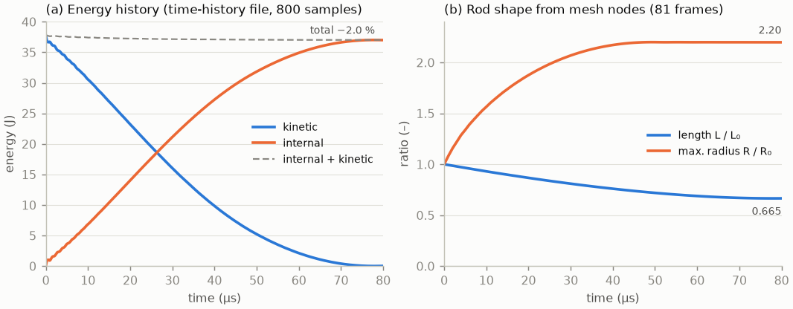
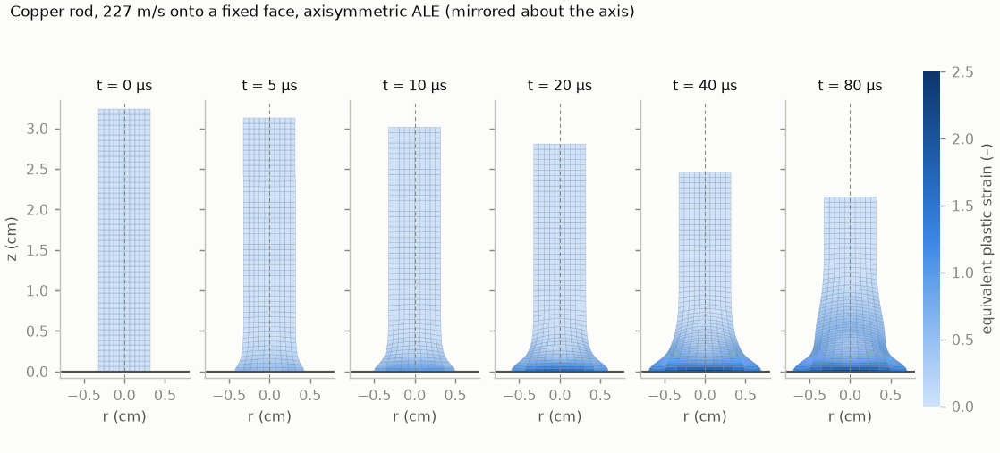
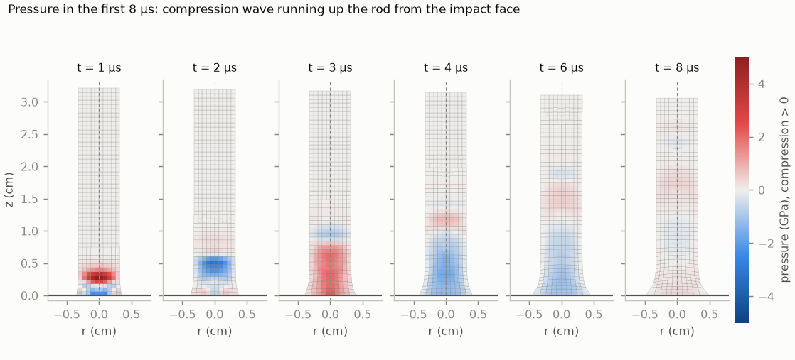
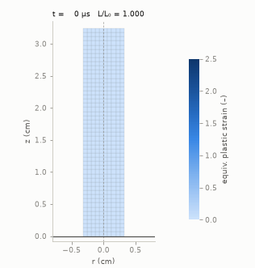

# OpenRadioss setup for the cold-spray track (WSL)

Session of 2026-11-03, prompt [coldspray-openradioss-setup-prompt.md](coldspray-openradioss-setup-prompt.md).
Goal: a verified, reproducible installation and one smoke run. No cold-spray result, no critical velocity.

**Main finding: OpenRadioss as named in the prompt and in DECISIONS 2026-11-03 no longer exists as a public
project.** Peter chose (2026-11-03, option 1) to use **OpenCourant**, a community fork of the last public
OpenRadioss code. Everything below refers to OpenCourant unless stated otherwise. DECISIONS and the prompt were not
edited; that is Peter's call.

**Usage rule (Peter, 2026-11-03):** use OpenCourant as installed, locally (`~/opt/opencourant/latest-20261011`).
Never commit its binaries, libraries or result files. Keep the shipped QA decks (CC BY-NC 4.0) out of the repository;
cite them by path and commit only.

## 1. Verified facts (checked 2026-11-03)

### 1.1 Status of OpenRadioss

| Fact | Source |
|---|---|
| `github.com/OpenRadioss/OpenRadioss` returns 404 (web and API). The org `OpenRadioss` exists, `public_repos: 0`, org updated 2026-10-21. | `https://api.github.com/repos/OpenRadioss/OpenRadioss`, `https://api.github.com/orgs/OpenRadioss` |
| `openradioss.org` redirects to a Siemens page "The future of Radioss is Simcenter": "The OpenRadioss website is being retired". It points to the commercial Simcenter Radioss and to a "Shared Source" R&D program (SCRDP, application-only). No AGPL download is offered. | `https://www.openradioss.org/` (301 → www, page served by siemens.com) |
| No public archive of the upstream repo: Software Heritage has no origin `github.com/OpenRadioss/OpenRadioss`. The Wayback Machine has no snapshot of its releases page. | `https://archive.softwareheritage.org/api/1/origin/https://github.com/OpenRadioss/OpenRadioss/visit/latest/` ("not found"), `http://archive.org/wayback/available?url=github.com/OpenRadioss/OpenRadioss/releases/latest` |
| The fork states that "the upstream repository was removed by Siemens on October 1, 2026, and no public archive was left". It gives the last upstream commit as `1a0d691b82bd4f94a3bc2399682551e84e1d5fa4`, snapshot date 2026-09-28. **This is the fork's own claim; I could not check it independently.** | `COPYRIGHT.md` in the release package and in the OpenCourant repo |

### 1.2 OpenCourant: licence, release, provenance

| Fact | Source |
|---|---|
| Repo `github.com/OpenCourant/OpenCourant`, org created 2026-10-02, last push 2026-11-02, 422 stars. It describes itself as "the community continuation of OpenRadioss". | GitHub API `repos/OpenCourant/OpenCourant`; `README.md` |
| **Licence of the solver: AGPL-3.0** (GitHub `spdx_id: AGPL-3.0`). Original work © Siemens / Altair, modifications © OpenCourant contributors, same terms. The starter banner prints "Licensed under GNU Affero General Public License". | GitHub licence API; `COPYRIGHT.md`; `starter.log` of the smoke run |
| **Not AGPL, Siemens permission "solely in connection with OpenRadioss software":** `extlib/hm_reader` (closed binary, the deck reader), `extlib/h3d` (H3D output library) and `hm_cfg_files` (keyword definitions; modifications "must be provided back to SISW"). Whether that permission covers a fork is a **legal question I did not resolve**. | `licenses/hm_reader_license.txt`, `licenses/h3d_license.txt`, header of `hm_cfg_files/config/CFG/radioss2026/data_hierarchy.cfg` |
| The hm_reader shipped in this release (v82, build `20260918_f907fe76`) "was recovered from a community-donated source checkout", "authenticated by byte-identical H3D libraries against the preserved upstream git history". **The fork's claim, not checked here.** | Release notes of `latest-20261011` |
| Signed git tag `openradioss-final` (tag object `a250886a`, 2026-10-08, PGP-signed) → commit `1a0d691b`, message "Last publicly available release of OpenRadioss". | `https://api.github.com/repos/OpenCourant/OpenCourant/git/tags/a250886a3b6140715b58426e724dbb5d029ae58b` |
| **Latest release: `latest-20261011`, published 2026-10-11T15:05:30Z**, built from commit `cb760c206e346eff12161a2268b134ef9d48a4ef` ("Adopt the recovered official extlib v82"). The CI note says "full MiniQA passes 81/81". The other releases are `latest-20261006` and `latest-20261005`. There is no formal `vYYYY.N` release yet. | `https://api.github.com/repos/OpenCourant/OpenCourant/releases` |
| **Retention risk:** "Three builds are available: they are based on the last three tags marking OpenCourant as stable." Only formal `vYYYY.N` releases are "kept permanently". So `latest-20261011` may be pruned. The verified zip is therefore kept locally (see 2.1). | `RELEASES.md`, `VERSIONING.md` |
| Known limitation in this release: `/ALE/STRUCTURED_MESH` is disabled (`HM_READER_NO_STRUCTURED_ALE=ON`) because it "generates degenerate meshes". | Release notes of `latest-20261011` |

### 1.3 Platforms and prerequisites

| Fact | Source |
|---|---|
| Prebuilt Linux packages run on Rocky Linux 8+, RHEL 8+, Ubuntu 20.x+. Linux x86-64 and arm64; Windows x64. Each is a zip or an Apptainer `.sif`. | `RELEASES.md`; release assets |
| Building from source needs glibc ≥ 2.17, GCC/gfortran ≥ 11, CMake ≥ 2.8, GNU make, perl, python3, git-lfs. WSL2 Ubuntu is listed as supported. | `HOWTO.md` (commit `cb760c2`) |
| Running needs `OPENCOURANT_PATH`, `RAD_CFG_PATH`, `RAD_H3D_PATH`, `OMP_STACKSIZE=400m` and `LD_LIBRARY_PATH` including `extlib/hm_reader/linux64`. MPI needs an Open MPI on the path. | `INSTALL.md` (commit `cb760c2`) |
| **Install route: a prebuilt Linux release exists, so no source build was needed.** | release assets |

### 1.4 Features needed for cold spray

Evidence comes at two levels. (a) The **keyword is defined** in the keyword configuration shipped with this
release (`hm_cfg_files/config/CFG/…`), which shows the current starter parses it. (b) The **documented
behaviour** is in the Altair Radioss 2022 manuals that the OpenCourant README links to: Reference Guide (RG) and
Theory Manual (TM), `https://2022.help.altair.com/2022/simulation/pdfs/radopen/AltairRadioss_2022_{ReferenceGuide,TheoryManual}.pdf`.
These manuals describe Radioss 2022, not this build. Any behaviour we rely on has to be confirmed by a run.

| Feature | Keyword(s) | Evidence |
|---|---|---|
| Explicit dynamics | Starter + Engine, `/RUN`, `/DT…` | Explicit central-difference solver throughout TM; smoke run below. |
| Johnson–Cook plasticity | `/MAT/LAW2` (`PLAS_JOHNS`) | RG p.472 ff; TM p.326–328; cfg `radioss2025/MAT/matl2_plas_johns.cfg` (fields `MAT_M`, `MAT_TMELT`, `MAT_SPHEAT`, `MAT_TREF`, `MAT_TMAX`). TM p.326: "valid for brick, shell, truss and beam elements". |
| Johnson–Cook + any EOS | `/MAT/LAW4` (`HYD_JCOOK`) | RG p.488: "compatible with solid elements only"; TM p.370: "you can choose any available EOS from /EOS card" (unlike LAW2). **Needed for JC + Mie–Grüneisen.** |
| Mie–Grüneisen EOS | `/EOS/GRUNEISEN` | RG p.1234 (cubic Us–up fit `C, S1, S2, S3`, `γ0`, `a`, `E0`). Compatible with LAW3, LAW4, LAW6, LAW10, … (RG p.1234, comment 4). cfg `radioss2612/MAT/mat_EOS.cfg`. |
| Adiabatic heating | LAW2/LAW4 built-in; `/HEAT/MAT` | TM p.327 (eq. 900): "adiabatic conditions are assumed for temperature computation", T from internal energy and ρc_p. RG LAW2 comments 11–15: T constant if ρc_p = 0. `/HEAT/MAT` (RG p.1223) has `EFRAC` = "fraction of strain energy converted into heat" (Taylor–Quinney). It works with EOS only for LAW3, 4, 12, 49 (comment 4). |
| ALE | `/ALE/MAT`, `/ALE/GRID/DONEA`, `…/SPRING`, `…/DISP`, `/EULER/MAT`, `/ALE/BCS` | RG p.141, p.1207, p.1209; TM p.423 ff. Shipped QA deck `qa-tests/miniqa/ALE2D/bar2_v41` (axisymmetric ALE, LAW3 copper). |
| SPH | `/PROP/TYPE34`, `/SPHCEL`, `/SPHBCS` | RG p.1753, p.193; TM p.440 ("Smooth Particle Hydrodynamics"). Shipped QA deck `qa-tests/miniqa/SPH/WavesCompression`. |
| Contact | `/INTER/TYPE7`, `/TYPE24`, `/TYPE25`; rigid walls `/RWALL/PLANE`, `CYL`, `SPHER`, `PARAL`, `/RWALL/THERM` | RG p.252 (TYPE7), p.361 (TYPE25), p.1922 (RWALL, with sliding and friction), p.2169 (RWALL/THERM). TYPE7 + RWALL/PLANE are exercised by the smoke run. |
| Axisymmetric 2D | `/ANALY` with `N2D3D = 1`; `/QUAD` elements | RG p.100–101: Y radial, Z axis of revolution, mesh in the YZ plane, "should never cross the axis Y=0". `/QUAD` = 4-node 2D solid in the YZ plane (RG p.182). TM p.80: "4-node quadrilaterals for plane strain and axisymmetrical analysis". cfg `radioss2026/CARDS/analy.cfg`. |
| Solid formulations (for distortion) | `/PROP/TYPE14` `Isolid` (1, 2, 14, 16, 17, 18, 24, …), `Ismstr` | RG p.1739 ff. Not yet assessed for the jet. |

## 2. Installation (done)

Machine: WSL2 kernel 6.6.87.2, Ubuntu 24.04.3 LTS, 32 logical CPUs, 15 GB RAM visible to WSL.
No sudo; nothing installed system-wide. Pre-existing system tools used: GNU Fortran 13.3.0 (Ubuntu
13.3.0-6ubuntu2~24.04.1), Open MPI 4.1.6 (`mpirun --version`), CMake (not used).

### 2.1 Commands

```bash
# download (83.9 MB) into an empty directory, then verify
curl -sSL -o OpenCourant_linux64.zip \
  https://github.com/OpenCourant/OpenCourant/releases/download/latest-20261011/OpenCourant_linux64.zip
sha256sum OpenCourant_linux64.zip
# 6cb419677ca36d73acb96218cc0cf5e4f7d50494d9c7812ba27935e3c0f8ec94  == GitHub asset digest

I=~/opt/opencourant/latest-20261011
mkdir -p $I && cd $I && unzip -q /path/to/OpenCourant_linux64.zip
cp /path/to/OpenCourant_linux64.zip $I/ && sha256sum OpenCourant_linux64.zip > OpenCourant_linux64.zip.sha256
```

Install path `~/opt/opencourant/latest-20261011` (the prompt said `~/opt/openradioss/<tag>`; renamed after the
product, same scheme). 305 MB on disk including the kept zip.

Environment file `~/opt/opencourant/latest-20261011/env.sh`, taken from `INSTALL.md`:

```bash
export OPENCOURANT_PATH=$HOME/opt/opencourant/latest-20261011/OpenCourant
export RAD_CFG_PATH=$OPENCOURANT_PATH/hm_cfg_files
export RAD_H3D_PATH=$OPENCOURANT_PATH/extlib/h3d/lib/linux64
export OMP_STACKSIZE=400m
export LD_LIBRARY_PATH=$OPENCOURANT_PATH/extlib/hm_reader/linux64/:$LD_LIBRARY_PATH
export PATH=$OPENCOURANT_PATH/exec:$PATH
```

### 2.2 Binaries (`$OPENCOURANT_PATH/exec/`)

| Binary | Role |
|---|---|
| `starter_linux64_gf` (`_sp`) | Starter (double / single precision). Banner: "Linux 64 bits, GNU compiler, Double Precision Version, CommitID: cb760c206e346eff12161a2268b134ef9d48a4ef" |
| `engine_linux64_gf` (`_sp`) | Engine, OpenMP only |
| `engine_linux64_gf_ompi` (`_sp`) | Engine, MPI + OpenMP; links the system `libmpi.so.40` (Open MPI 4.1.6) |
| `anim_to_vtk_linux64_gf`, `th_to_csv_linux64_gf` | Output converters (MIT, `OpenCourant/Tools`) |

`ldd` shows no missing libraries for starter, engine and MPI engine once `env.sh` is sourced.

## 3. Smoke tests (done: serial, 4-rank MPI, converters, axisymmetric ALE)

**Deck:** `qa-tests/miniqa/INTERF/INT_7/small_boule/data/BOULE1V4_0000.rad` + `BOULE1V4_0001.rad` +
`qadiags.inc`, at commit `cb760c2`. Readme: "Ball impact on the wall with /INTER/TYPE7". The model has
`/MAT/PLAS_JOHNS` (Johnson–Cook, "acier XES standard"), two `/INTER/TYPE7`, `/RWALL/PLANE`, `/IMPVEL`; the ball is a
**shell** sphere (`/SHELL`, `/PROP/TYPE1`), 2 parts, 1 material. In this deck the JC parameters are
a = 180, b = 450, n = 0.5, σ_max = 380, **c = 0 and m = 0**. The rate and temperature terms are therefore
not exercised.

Deck licence: header "Model is licensed by Holder [Siemens] under CC BY-NC 4.0". It is **not committed** here, only
cited by path and commit.

```bash
. ~/opt/opencourant/latest-20261011/env.sh
export OMP_NUM_THREADS=1
cp .../small_boule/data/{BOULE1V4_0000.rad,BOULE1V4_0001.rad,qadiags.inc} <rundir>/ && cd <rundir>
starter_linux64_gf -i BOULE1V4_0000.rad -np 1
engine_linux64_gf  -i BOULE1V4_0001.rad
```

| Item | Value |
|---|---|
| Cores | 1 process, 1 OpenMP thread |
| Starter | exit 0; wall 0.25 s (`/usr/bin/time`), max RSS 154 MB; 3 warnings (100214 unsupported `/IOFLAG` field; 2× 1912 shell NPT=0 → 3 points) |
| Engine | exit 0, "NORMAL TERMINATION", 2098 cycles to t = 0.13; elapsed 0.15 s; max RSS 38 MB |
| Against the shipped reference | All 6 printed energy rows of `BOULE1V4_0001.out` (cycles 0, 1600–2000) are **identical** to `reference/BOULE1V4_0001.out`. Cycle 2000: t = 0.1246, dt = 0.4930E-04, IE = 1943, KE_t = 34.91, KE_r = 22.18, ExtWork = −3.014. These match `data/ref.extract`. |
| Outputs | `BOULE1V4_0000.out`, `BOULE1V4_0001.out` (listings), `BOULE1V4A001.gz`…`A008.gz` (animation, gzipped because of `/ANIM/GZIP`), `BOULE1V4T01` (time history), `BOULE1V4_0000_0001.rst`, `BOULE1V4_0001_0001.rst` (restart). About 1.2 MB in total. |

Run directory (temporary, not kept in the repo): the session scratchpad, `run_serial/`.

### 3.1 MPI run (4 ranks)

Same inputs, in a fresh directory:

```bash
. ~/opt/opencourant/latest-20261011/env.sh
export OMP_NUM_THREADS=1
starter_linux64_gf -i BOULE1V4_0000.rad -np 4
mpiexec -n 4 --bind-to core engine_linux64_gf_ompi -i BOULE1V4_0001.rad
```

| Item | Value |
|---|---|
| Cores | 4 SPMD domains × 1 thread (listing: "NUMBER OF SPMD DOMAINS 4", "THREADS PER DOMAIN 1"), Open MPI 4.1.6 |
| Starter | exit 0; wall 0.45 s |
| Engine | exit 0, "NORMAL TERMINATION", 2098 cycles; engine elapsed 0.47 s, `mpiexec` wall 0.62 s. The model is too small for MPI to help: 4 ranks are slower than 1 rank |
| Against reference and serial | All 6 printed energy rows are **identical** to the reference and to the serial run (`/PARITH/ON` in the engine deck) |
| Extra outputs | One restart file per domain: `BOULE1V4_000{0,1}_000{1..4}.rst` |

### 3.2 Output conversion

```bash
gunzip -k BOULE1V4A00?.gz                     # needed: anim_to_vtk on a .gz file exits 1 with no output
for f in BOULE1V4A00?; do anim_to_vtk_linux64_gf $f > $f.vtk; done
th_to_csv_linux64_gf BOULE1V4T01              # writes BOULE1V4T01.csv
```

- `anim_to_vtk`: 8 legacy ASCII VTK files (`UNSTRUCTURED_GRID`, about 7 kB each), 154 points, 115 cells. Fields:
  `TIME`, `CYCLE`, `NODE_ID`, `ELEMENT_ID`, `PART_ID`, `EROSION_STATUS`. **No stress, strain or temperature fields**,
  because this deck requests no `/ANIM/ELEM` or `/ANIM/NODA` output. Our own decks must request them, e.g. plastic
  strain, temperature and pressure. Observation: the `FieldData` `CYCLE` reads 0 even in `A008` (TIME 0.130053);
  use `TIME`, not `CYCLE`.
- `th_to_csv`: "CONVERSION COMPLETED"; `BOULE1V4T01.csv` has 131 rows and named columns (`"time"`, `"INTERNAL
  ENERGY"`, `"KINETIC ENERGY"`, momenta, `"CONTACT ENERGY"`, `"HOURGLASS ENERGY"`, `"PLASTIC WORK"`, …, and the
  per-part `BOULE … IE/KE/…` columns). It is directly readable from Python (`csv` / `numpy`).

### 3.3 Axisymmetric ALE deck: copper rod impact (Taylor-type)

**Deck:** `qa-tests/miniqa/ALE2D/bar2_v41/data/BAR2V41B_0000.rad` + `BAR2V41B_0001.rad` + `qadiags.inc` at
commit `cb760c2` (readme: "ALE 2D IMPACT 227M/S TEST ALE ELASTOPLAST"; © Siemens, CC BY-NC 4.0, not committed).
`BAR2V41BD02` in the same folder is an old generated deck that is not included, so it was not used.

- `/ANALY` N2D3D = 1 (axisymmetric), one part of 250 `/QUAD` elements (CELL_TYPE 9), 306 nodes, `/ALE/MAT` with
  `/ALE/GRID/DONEA`, `/MAT/LAW3` (HYDPLA) "CUIVRE" with linear hardening (a = 0.004, b = 0.001, n = 1). `/PROP/TYPE14`
  q_a = q_b = 0, i.e. the defaults 1.10 and 0.05 (RG p.1703–1704).
- Rod R₀ = 0.32 cm, L₀ = 3.24 cm, `/INIVEL` v_z = −0.0227 onto a face held by `/BCS` at z = 0.
- **Units, inferred:** the `/BEGIN` card says kg–m–s, but the values only fit **g–cm–µs** (ρ = 8.93, E = 1.17 Mbar,
  v = 0.0227 cm/µs = 227 m/s, t_end = 80 µs). Check: mass 1.481 g, ½ m v² = 38.2 J, and the listing's initial
  KE 3.779e‑4 g·cm²/µs² = 37.8 J.

```bash
. ~/opt/opencourant/latest-20261011/env.sh; export OMP_NUM_THREADS=1
starter_linux64_gf -i BAR2V41B_0000.rad -np 1     # exit 0, 0 errors, 1 warning (100214 /IOFLAG field); 0.43 s
engine_linux64_gf  -i BAR2V41B_0001.rad           # NORMAL TERMINATION, 4349 cycles, elapsed 0.42 s, 1 core
```

**Against the shipped reference.** The reference listing was produced by upstream commit `440deeba` (2022-11),
not by this build, and the printed rows are **not bit-identical**:

- the cycle numbers of all 44 printed rows match, and so does the mass;
- the initial time step differs by 1.7 % (0.04451 vs 0.04529);
- time differs by ≤ 0.15 % and IE by ≤ 0.10 %;
- KE differs by ≤ 1.2 % relative, at late times when KE is near zero.

At the QA extract point (cycle 4300) cycle, time, time step and IE agree to the printed digits. KE is 9.718e‑8
vs 9.767e‑8, an absolute difference of 4.9e‑10, below the QA's default `Zero_Tolerance 5.0e-8`
(`qa-tests/scripts/or_QA.constants`). So the run plausibly passes the shipped QA criterion. I did not run the QA
script itself.

**Animation copy.** For the plots, a local copy of the engine deck was run with `/ANIM/DT` every 1 µs (81 frames)
instead of 10 µs. Its energy rows are identical to the unmodified run. Converted with `anim_to_vtk` (after
gunzip) and `th_to_csv`. The VTK files carry `2DELEM_Plastic_Strain` and `2DELEM_Pressure`, requested in the
deck by `/ANIM/ELEM/EPSP` and `/ANIM/ELEM/P`. Figures made by
[`openradioss/scripts/plot_bar2.py`](openradioss/scripts/plot_bar2.py) (with
[`vtkread.py`](openradioss/scripts/vtkread.py)):
`python plot_bar2.py <vtk_dir> <BAR2V41BT01.csv> <out_dir>` (numpy, matplotlib, pillow).

| Quantity (t = 80 µs) | Value |
|---|---|
| L / L₀ | 0.665 (2.156 cm) |
| max. radius R / R₀ | 2.20 (0.703 cm) |
| max. equivalent plastic strain | 2.35 (at the impact face) |
| plastic work / initial KE | 0.97 |
| energy balance (IE + KE) | −2.0 % (listing ERROR column −2.0 %); hourglass energy 0, external work 0 |
| peak cell pressure, frames at 1–8 µs | 4.9 GPa |



*(a)* Kinetic energy goes into internal energy, and the rod is essentially at rest by 75 µs. The dashed total
loses 2.0 %. This is not hourglass energy (zero); ALE advection is a likely source, not checked. *(b)* The
radius saturates at about 50 µs, the length at about 70 µs.



Equivalent plastic strain on the deformed ALE mesh, mirrored about the axis for readability (the model is the
half r ≥ 0). Strain concentrates in a thin layer at the impact face; the mushroom foot spreads to 2.2 R₀.



Pressure (positive in compression, TM p.94) in the first 8 µs: a compression front of about 0.4 cm/µs runs up
the rod. **Not understood:** behind the front the sign alternates, down to about −4 GPa (tension) near the face
at 2 µs. That is unexpected for a rod held against the face. Possible causes are ringing on this coarse mesh
(5 radial × 50 axial cells, frames 1 µs apart) or how `/BCS` holds the face nodes. Not investigated; to check
before trusting pressure or interface tension in our own decks (item 1 in section 5).

Animation (81 frames, 10 fps, 0.8 MB): [bar2_plastic_strain.gif](openradioss/figures/bar2_plastic_strain.gif)



## 4. What did not work or was not done

- **The prompt's premise:** "official OpenRadioss sources" no longer exist (section 1.1). Peter decided to use the fork.
- First starter run: `ERROR ID 100002 Include file qadiags.inc not found`. My mistake: I had copied only the two
  `.rad` files. Fixed by copying `qadiags.inc` (a comment-only include).
- The MPI run and the converters were blocked at first by the Claude Code auto-mode classifier ("Code from
  External"). After Peter allowed them, they ran (3.1, 3.2).
- `anim_to_vtk` does not read gzipped animation files: gunzip first.
- The manuals are Altair Radioss **2022**, the only ones linked by the fork. There is no OpenCourant-specific
  manual yet.
- No source build, no Apptainer image (not needed).

## 5. What we still need to check

1. **Axisymmetric support in practice:** `ALE2D/bar2_v41` runs (axisymmetric, ALE, LAW3 on `/QUAD`; section 3.3).
   Still open: (a) whether LAW4 (JC + `/EOS/GRUNEISEN`) is accepted on `/QUAD` elements under N2D3D = 1;
   (b) the alternating-sign pressure behind the front in 3.3 (mesh refinement, `/BCS` versus rigid wall,
   bulk viscosity); (c) the −2 % energy drift under ALE.
   RG says only "solid elements" for LAW4, and TM lists LAW2 for "brick, shell, truss and beam", not quads.
   Look for the RD-E 0800 "Hopkinson Bar" example cited under `/ANALY`.
2. **Rigid-wall contact for particle on substrate:** `/RWALL/PLANE` (sliding flag, friction) versus
   `/INTER/TYPE7` or `TYPE25` against a deformable substrate, and whether either works with `/QUAD` in 2D
   axisymmetric. `/RWALL/THERM` exists if heat flow into the wall matters.
3. **Elements for extreme distortion at the jet:** options are Lagrangian `/QUAD` with remeshing (not
   available?), ALE (`/ALE/GRID/DONEA`, `SPRING`; note that `/ALE/STRUCTURED_MESH` is disabled in this release),
   SPH (`/PROP/TYPE34`), and `/PROP/TYPE14` `Isolid` and `Ismstr` choices. Check the element-deletion and time-step
   controls (`/DT/…`) and whether a minimum time step silently stops the run before the jet forms.
4. **Mesh-convergence options:** how the element size at the contact zone is controlled (the deck generator is
   ours). Whether `/ADMAS` or mass scaling must stay off (it biases the dynamics), and which output (`/TH`, `/ANIM`
   element variables: PEEQ, T, pressure) gives the jet and interface quantities we will converge on.
5. **Parameter sweeps (impact velocity) from Python:** the decks are plain text. The plan is to generate the starter
   deck from a template (`/INIVEL` or `/IMPVEL` value), run starter + engine via `subprocess` in one directory per
   case, then parse the `T01` time history (`th_to_csv` works, 3.2), the VTK fields (`anim_to_vtk`, with
   `/ANIM/ELEM` requests added) and the `.out` energy rows. Check: run-time scaling with
   mesh size, `-np`/`OMP_NUM_THREADS` choice, and the `qa-tests/miniqa/PYTHON/FUNCT_PYTHON` feature (Python functions
   inside the deck).
6. **Reproducibility:** pin `latest-20261011` (zip kept locally with its SHA-256). Move to the first formal
   `vYYYY.N` release when it exists, and re-run the smoke test plus the reference comparison after any upgrade.
7. **Licence (settled by Peter, 2026-11-03):** the risk from the Siemens-only parts (`hm_reader`, `H3D`,
   `hm_cfg_files`, "solely in connection with OpenRadioss software") lies in redistributing or publishing things
   that depend on them. Running OpenCourant locally for research distributes nothing, and our own input decks and
   result numbers are ours. Rule: do not redistribute the package, its closed libraries or the cfg files, and do not
   ship anything that bundles them. Before publishing a deck, check it is our own and not derived from the
   CC BY-NC 4.0 QA decks.
8. **Cross-check against the independent JAX code** (`src/schemeforge/research/impact_axisym.py`, rung 1) on a
   shared elastic or elastic-plastic case before any cold-spray number is produced.
